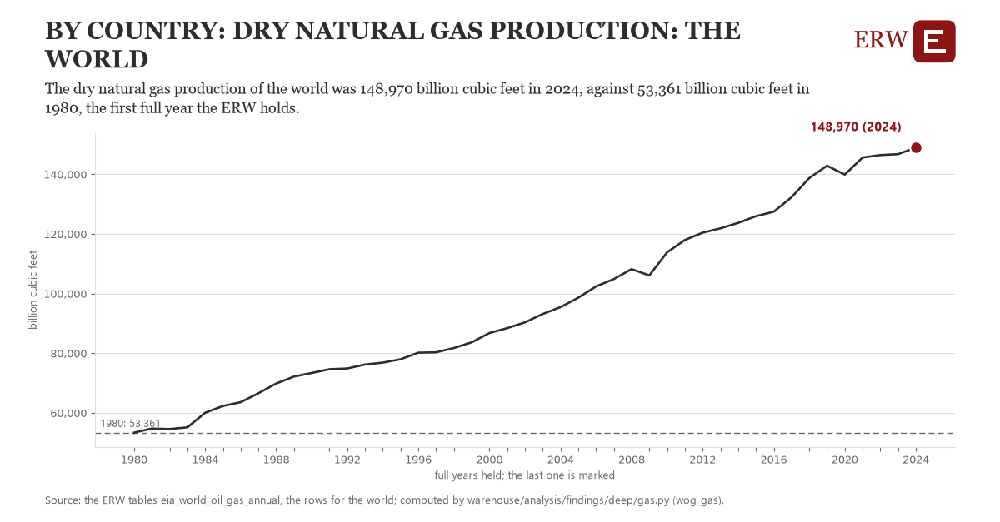

# By country: dry natural gas production: the world

Draft `scan-deep-036bd3f07a8e` of the findings hunt over the whole warehouse (chain 502), 2026-11-19. State: draft, not reviewed. Review at `/internal/findings`.

**The finding.** The dry natural gas production of the world was 148,970 billion cubic feet in 2024, against 53,361 billion cubic feet in 1980, the first full year the ERW holds.

**The figure by full year** (billion cubic feet): 1980: 53,361, 1981: 54,740, 1982: 54,564, 1983: 55,146, 1984: 60,029, 1985: 62,304, 1986: 63,588, 1987: 66,582, 1988: 69,840, 1989: 72,170, 1990: 73,379, 1991: 74,635, 1992: 74,881, 1993: 76,206, 1994: 76,842, 1995: 77,966, 1996: 80,176, 1997: 80,299, 1998: 81,735, 1999: 83,642, 2000: 86,770, 2001: 88,407, 2002: 90,344, 2003: 93,141, 2004: 95,444, 2005: 98,598, 2006: 102,383, 2007: 104,846, 2008: 108,192, 2009: 106,090, 2010: 113,823, 2011: 117,951, 2012: 120,430, 2013: 121,867, 2014: 123,709, 2015: 125,939, 2016: 127,448, 2017: 132,288, 2018: 138,725, 2019: 142,862, 2020: 139,907, 2021: 145,615, 2022: 146,438, 2023: 146,749, 2024: 148,970.

**The tables and rows.** `eia_world_oil_gas_annual`; the rows for the world, region key `wog_worl` (the card's `hunt.region`), years 1980 to 2024. The yearly values: `wog-gas-wog-worl.csv`.

**Its strength.** The change is 29.11 typical yearly moves (a typical move is 3,284 billion cubic feet, 1.4826 times the median absolute change between full years). Holds in more than one year: 44 of the 44 full years after 1980 lie above 1980's value. Survives a change of window: from 1981 to 2024 the change is 94,230, from 1980 to 2023 it is 93,388. Sample large enough: 1980 holds 1 and 2024 holds 1 observations; the floor is 1. Half the change remains without the first year: from 1981 to 2024 the change is 94,230, 98.6 percent of the change from 1980. At least one typical yearly move: the change is 29.11 typical yearly moves (3,284 billion cubic feet a year, the median move between full years); the floor is 1.

**Its limits.** EIA's international energy data as the latest bulk file holds them; a country's recent years are often EIA's estimates; from 1980, when the series begin for every country.

**Reproduce.** `python wog-gas-wog-worl.reproduce.py <the table's CSV>` and `do wog-gas-wog-worl.reproduce.do` (Stata) recompute the figures by year from the tables as the public downloads hold them; each names the expected values at its top.
