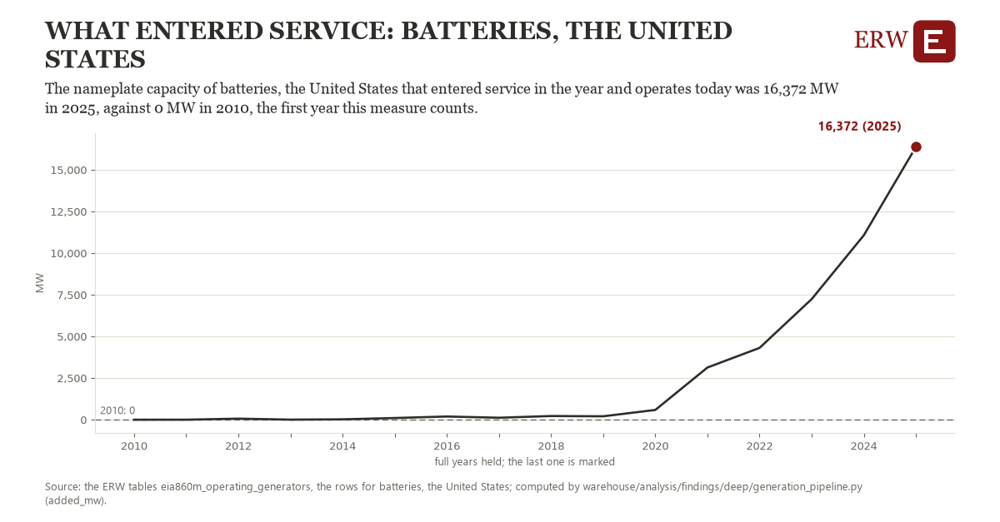

# What entered service: batteries, the United States

Draft `scan-deep-dbdda8d8c6f2` of the findings hunt over the whole warehouse (chain 164), 2026-11-06. State: draft, not reviewed. Review at `/internal/findings`.

**The finding.** The nameplate capacity of batteries, the United States that entered service in the year and operates today was 16,372 MW in 2025, against 0 MW in 2010, the first year this measure counts.

**The figure by full year** (MW): 2010: 0, 2011: 1, 2012: 62, 2013: 4, 2014: 22, 2015: 101, 2016: 192, 2017: 118, 2018: 220, 2019: 205, 2020: 585, 2021: 3,132, 2022: 4,309, 2023: 7,238, 2024: 11,066, 2025: 16,372.

**The tables and rows.** `eia860m_operating_generators`; the rows for batteries, the United States, region key `add_battery_US` (the card's `hunt.region`), years 2010 to 2025. The yearly values: `added-mw-add-battery-us.csv`.

**Its strength.** The change is 120.95 typical yearly moves (a typical move is 135 MW, 1.4826 times the median absolute change between full years). Holds in more than one year: 15 of the 15 full years after 2010 lie above 2010's value. Survives a change of window: from 2011 to 2025 the change is 16,372, from 2010 to 2024 it is 11,066. Sample large enough: 2010 holds 1 and 2025 holds 1 observations; the floor is 1. Half the change remains without the first year: from 2011 to 2025 the change is 16,372, 100.0 percent of the change from 2010. At least one typical yearly move: the change is 120.95 typical yearly moves (135 MW a year, the median move between full years); the floor is 1.

**Its limits.** EIA-860M's generators that operate today, by the year they entered service: a unit built and since retired is not counted, and the latest months are preliminary.

**Reproduce.** `python added-mw-add-battery-us.reproduce.py <the table's CSV>` and `do added-mw-add-battery-us.reproduce.do` (Stata) recompute the figures by year from the tables as the public downloads hold them; each names the expected values at its top.
