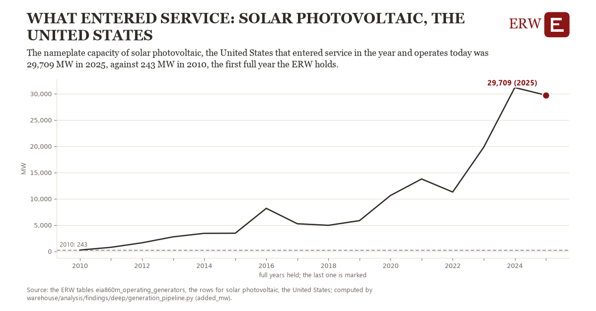

# What entered service: solar photovoltaic, the United States

Draft `scan-deep-a222729a0c70` of the findings hunt over the whole warehouse (chain 164), 2026-11-06. State: draft, not reviewed. Review at `/internal/findings`.

**The finding.** The nameplate capacity of solar photovoltaic, the United States that entered service in the year and operates today was 29,709 MW in 2025, against 243 MW in 2010, the first full year the ERW holds.

**The figure by full year** (MW): 2010: 243, 2011: 763, 2012: 1,626, 2013: 2,756, 2014: 3,423, 2015: 3,447, 2016: 8,179, 2017: 5,247, 2018: 4,951, 2019: 5,841, 2020: 10,638, 2021: 13,769, 2022: 11,288, 2023: 19,822, 2024: 31,173, 2025: 29,709.

**The tables and rows.** `eia860m_operating_generators`; the rows for solar photovoltaic, the United States, region key `add_solar_US` (the card's `hunt.region`), years 2010 to 2025. The yearly values: `added-mw-add-solar-us.csv`.

**Its strength.** The change is 13.58 typical yearly moves (a typical move is 2,170 MW, 1.4826 times the median absolute change between full years). Holds in more than one year: 15 of the 15 full years after 2010 lie above 2010's value. Survives a change of window: from 2011 to 2025 the change is 28,946, from 2010 to 2024 it is 30,930. Sample large enough: 2010 holds 1 and 2025 holds 1 observations; the floor is 1. Half the change remains without the first year: from 2011 to 2025 the change is 28,946, 98.2 percent of the change from 2010. At least one typical yearly move: the change is 13.58 typical yearly moves (2,170 MW a year, the median move between full years); the floor is 1.

**Its limits.** EIA-860M's generators that operate today, by the year they entered service: a unit built and since retired is not counted, and the latest months are preliminary.

**Reproduce.** `python added-mw-add-solar-us.reproduce.py <the table's CSV>` and `do added-mw-add-solar-us.reproduce.do` (Stata) recompute the figures by year from the tables as the public downloads hold them; each names the expected values at its top.
