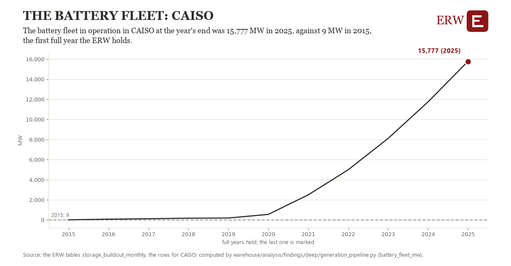

# The battery fleet: CAISO

Draft `scan-deep-42c7b168c0a1` of the findings hunt over the whole warehouse (chain 164), 2026-11-06. State: draft, not reviewed. Review at `/internal/findings`.

**The finding.** The battery fleet in operation in CAISO at the year's end was 15,777 MW in 2025, against 9 MW in 2015, the first full year the ERW holds.

**The figure by full year** (MW): 2015: 9, 2016: 73, 2017: 116, 2018: 169, 2019: 186, 2020: 547, 2021: 2,493, 2022: 4,986, 2023: 8,107, 2024: 11,746, 2025: 15,777.

**The tables and rows.** `storage_buildout_monthly`; the rows for CAISO, region key `caiso_fleet_battery_operating_mw` (the card's `hunt.region`), years 2015 to 2025. The yearly values: `battery-fleet-mw-caiso-fleet-battery-operating-mw.csv`.

**Its strength.** The change is 9.22 typical yearly moves (a typical move is 1,710 MW, 1.4826 times the median absolute change between full years). Holds in more than one year: 10 of the 10 full years after 2015 lie above 2015's value. Survives a change of window: from 2016 to 2025 the change is 15,704, from 2015 to 2024 it is 11,737. Sample large enough: 2015 holds 1 and 2025 holds 1 observations; the floor is 1. Half the change remains without the first year: from 2016 to 2025 the change is 15,704, 99.6 percent of the change from 2015. At least one typical yearly move: the change is 9.22 typical yearly moves (1,710 MW a year, the median move between full years); the floor is 1.

**Its limits.** EIA-860M's operating batteries as the ERW counts them each month; a battery that reports late joins its month when EIA lists it.

**Reproduce.** `python battery-fleet-mw-caiso-fleet-battery-operating-mw.reproduce.py <the table's CSV>` and `do battery-fleet-mw-caiso-fleet-battery-operating-mw.reproduce.do` (Stata) recompute the figures by year from the tables as the public downloads hold them; each names the expected values at its top.
