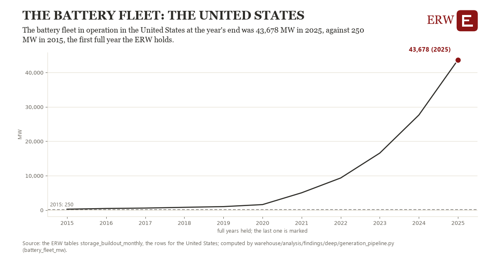

# The battery fleet: the United States

Draft `scan-deep-cace35476103` of the findings hunt over the whole warehouse (chain 164), 2026-11-06. State: draft, not reviewed. Review at `/internal/findings`.

**The finding.** The battery fleet in operation in the United States at the year's end was 43,678 MW in 2025, against 250 MW in 2015, the first full year the ERW holds.

**The figure by full year** (MW): 2015: 250, 2016: 461, 2017: 579, 2018: 799, 2019: 1,004, 2020: 1,589, 2021: 5,021, 2022: 9,330, 2023: 16,568, 2024: 27,634, 2025: 43,678.

**The tables and rows.** `storage_buildout_monthly`; the rows for the United States, region key `us_fleet_battery_operating_mw` (the card's `hunt.region`), years 2015 to 2025. The yearly values: `battery-fleet-mw-us-fleet-battery-operating-mw.csv`.

**Its strength.** The change is 14.58 typical yearly moves (a typical move is 2,978 MW, 1.4826 times the median absolute change between full years). Holds in more than one year: 10 of the 10 full years after 2015 lie above 2015's value. Survives a change of window: from 2016 to 2025 the change is 43,217, from 2015 to 2024 it is 27,384. Sample large enough: 2015 holds 1 and 2025 holds 1 observations; the floor is 1. Half the change remains without the first year: from 2016 to 2025 the change is 43,217, 99.5 percent of the change from 2015. At least one typical yearly move: the change is 14.58 typical yearly moves (2,978 MW a year, the median move between full years); the floor is 1.

**Its limits.** EIA-860M's operating batteries as the ERW counts them each month; a battery that reports late joins its month when EIA lists it.

**Reproduce.** `python battery-fleet-mw-us-fleet-battery-operating-mw.reproduce.py <the table's CSV>` and `do battery-fleet-mw-us-fleet-battery-operating-mw.reproduce.do` (Stata) recompute the figures by year from the tables as the public downloads hold them; each names the expected values at its top.
