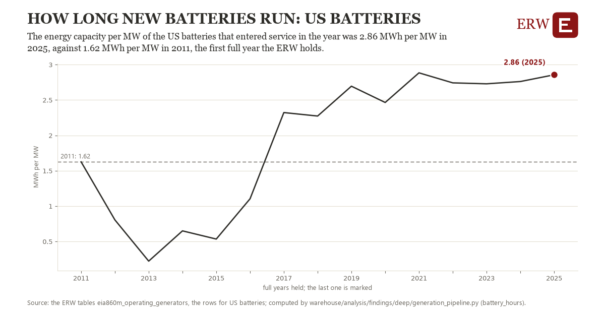

# How long new batteries run: US batteries

Draft `scan-deep-05c99ca8013f` of the findings hunt over the whole warehouse (chain 164), 2026-11-06. State: draft, not reviewed. Review at `/internal/findings`.

**The finding.** The energy capacity per MW of the US batteries that entered service in the year was 2.86 MWh per MW in 2025, against 1.62 MWh per MW in 2011, the first full year the ERW holds.

**The figure by full year** (MWh per MW): 2011: 1.62, 2012: 0.80, 2013: 0.22, 2014: 0.65, 2015: 0.53, 2016: 1.10, 2017: 2.32, 2018: 2.27, 2019: 2.70, 2020: 2.46, 2021: 2.88, 2022: 2.74, 2023: 2.73, 2024: 2.76, 2025: 2.86.

**The tables and rows.** `eia860m_operating_generators`; the rows for US batteries, region key `us_battery_hours` (the card's `hunt.region`), years 2011 to 2025. The yearly values: `battery-hours-us-battery-hours.csv`.

**Its strength.** The change is 2.56 typical yearly moves (a typical move is 0.48 MWh per MW, 1.4826 times the median absolute change between full years). Holds in more than one year: 9 of the 14 full years after 2011 lie above 2011's value. Survives a change of window: from 2012 to 2025 the change is 2.05, from 2011 to 2024 it is 1.14. Sample large enough: 2011 holds 1 and 2025 holds 1 observations; the floor is 1. Half the change remains without the first year: from 2012 to 2025 the change is 2.05, 166.6 percent of the change from 2011. At least one typical yearly move: the change is 2.56 typical yearly moves (0.48 MWh per MW a year, the median move between full years); the floor is 1.

**Its limits.** EIA-860M's generators that operate today, by the year they entered service: a unit built and since retired is not counted, and the latest months are preliminary. A battery's MWh is its reported energy capacity, not what it delivers in a cycle.

**Reproduce.** `python battery-hours-us-battery-hours.reproduce.py <the table's CSV>` and `do battery-hours-us-battery-hours.reproduce.do` (Stata) recompute the figures by year from the tables as the public downloads hold them; each names the expected values at its top.
