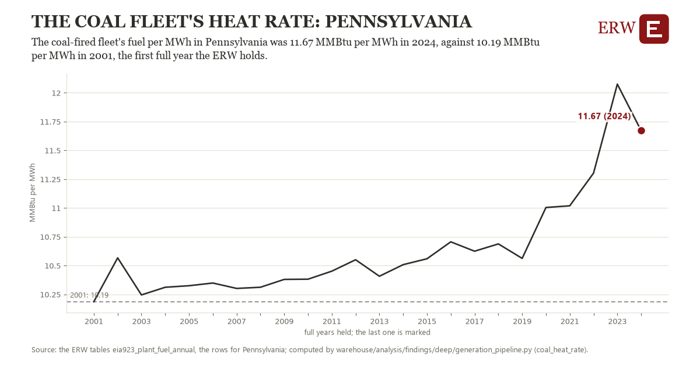

# The coal fleet's heat rate: Pennsylvania

Draft `scan-deep-92152fa1deb6` of the findings hunt over the whole warehouse (chain 164), 2026-11-06. State: draft, not reviewed. Review at `/internal/findings`.

**The finding.** The coal-fired fleet's fuel per MWh in Pennsylvania was 11.67 MMBtu per MWh in 2024, against 10.19 MMBtu per MWh in 2001, the first full year the ERW holds.

**The figure by full year** (MMBtu per MWh): 2001: 10.19, 2002: 10.57, 2003: 10.25, 2004: 10.31, 2005: 10.33, 2006: 10.35, 2007: 10.30, 2008: 10.31, 2009: 10.38, 2010: 10.38, 2011: 10.45, 2012: 10.55, 2013: 10.41, 2014: 10.51, 2015: 10.56, 2016: 10.71, 2017: 10.63, 2018: 10.69, 2019: 10.56, 2020: 11.00, 2021: 11.02, 2022: 11.30, 2023: 12.08, 2024: 11.67.

**The tables and rows.** `eia923_plant_fuel_annual`; the rows for Pennsylvania, region key `hr_coal_PA` (the card's `hunt.region`), years 2001 to 2024. The yearly values: `coal-heat-rate-hr-coal-pa.csv`.

**Its strength.** The change is 12.31 typical yearly moves (a typical move is 0.12 MMBtu per MWh, 1.4826 times the median absolute change between full years). Holds in more than one year: 23 of the 23 full years after 2001 lie above 2001's value. Survives a change of window: from 2002 to 2024 the change is 1.10, from 2001 to 2023 it is 1.89. Sample large enough: 2001 holds 1 and 2024 holds 1 observations; the floor is 1. Half the change remains without the first year: from 2002 to 2024 the change is 1.10, 74.4 percent of the change from 2001. At least one typical yearly move: the change is 12.31 typical yearly moves (0.12 MMBtu per MWh a year, the median move between full years); the floor is 1.

**Its limits.** EIA-923's total fuel consumed, combined heat and power plants' useful heat included; a fleet that runs less often runs at less efficient loads.

**Reproduce.** `python coal-heat-rate-hr-coal-pa.reproduce.py <the table's CSV>` and `do coal-heat-rate-hr-coal-pa.reproduce.do` (Stata) recompute the figures by year from the tables as the public downloads hold them; each names the expected values at its top.
