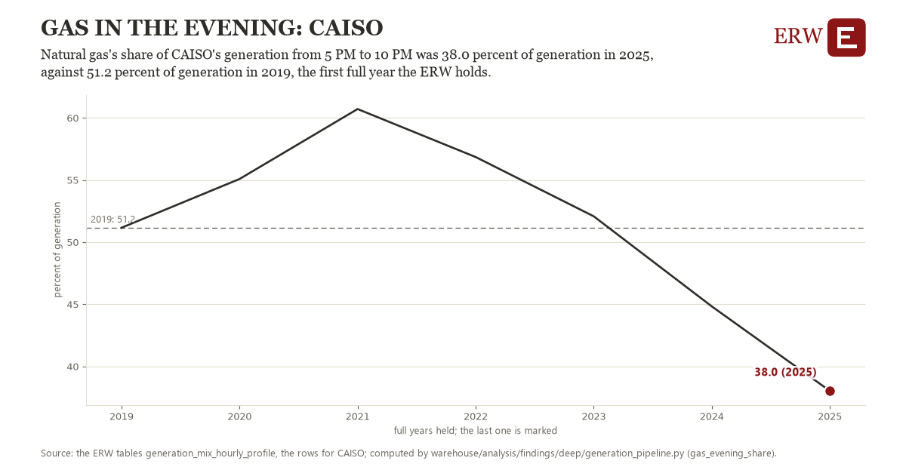

# Gas in the evening: CAISO

Draft `scan-deep-6deaba8ca881` of the findings hunt over the whole warehouse (chain 164), 2026-11-06. State: draft, not reviewed. Review at `/internal/findings`.

**The finding.** Natural gas's share of CAISO's generation from 5 PM to 10 PM was 38.0 percent of generation in 2025, against 51.2 percent of generation in 2019, the first full year the ERW holds.

**The figure by full year** (percent of generation): 2019: 51.2, 2020: 55.1, 2021: 60.7, 2022: 56.8, 2023: 52.1, 2024: 44.8, 2025: 38.0.

**The tables and rows.** `generation_mix_hourly_profile`; the rows for CAISO, region key `caiso_mix` (the card's `hunt.region`), years 2019 to 2025. The yearly values: `gas-evening-share-caiso-mix.csv`.

**Its strength.** The change is 1.70 typical yearly moves (a typical move is 7.7 percent of generation, 1.4826 times the median absolute change between full years). Holds in more than one year: 2 of the 6 full years after 2019 lie below 2019's value. Survives a change of window: from 2020 to 2025 the change is -17.0, from 2019 to 2024 it is -6.3. Sample large enough: 2019 holds 11 and 2025 holds 11 observations; the floor is 11. Half the change remains without the first year: from 2020 to 2025 the change is -17.0, 129.9 percent of the change from 2019. At least one typical yearly move: the change is 1.70 typical yearly moves (7.7 percent of generation a year, the median move between full years); the floor is 1.

**Its limits.** EIA-930 hourly generation as the ERW's monthly profile holds it; imports are not in the denominator, so a grid that imports more in the evening shows a share of what it generates, not of what it uses.

**Reproduce.** `python gas-evening-share-caiso-mix.reproduce.py <the table's CSV>` and `do gas-evening-share-caiso-mix.reproduce.do` (Stata) recompute the figures by year from the tables as the public downloads hold them; each names the expected values at its top.
