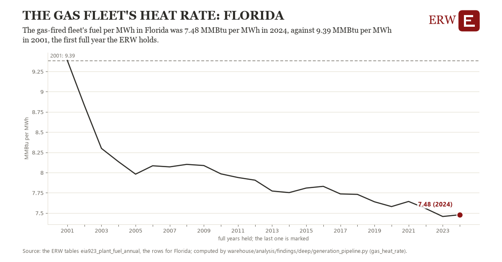

# The gas fleet's heat rate: Florida

Draft `scan-deep-9fd4e326766e` of the findings hunt over the whole warehouse (chain 164), 2026-11-06. State: draft, not reviewed. Review at `/internal/findings`.

**The finding.** The gas-fired fleet's fuel per MWh in Florida was 7.48 MMBtu per MWh in 2024, against 9.39 MMBtu per MWh in 2001, the first full year the ERW holds.

**The figure by full year** (MMBtu per MWh): 2001: 9.39, 2002: 8.83, 2003: 8.30, 2004: 8.13, 2005: 7.98, 2006: 8.08, 2007: 8.07, 2008: 8.10, 2009: 8.09, 2010: 7.98, 2011: 7.94, 2012: 7.91, 2013: 7.77, 2014: 7.75, 2015: 7.81, 2016: 7.83, 2017: 7.74, 2018: 7.73, 2019: 7.64, 2020: 7.58, 2021: 7.64, 2022: 7.56, 2023: 7.46, 2024: 7.48.

**The tables and rows.** `eia923_plant_fuel_annual`; the rows for Florida, region key `hr_gas_FL` (the card's `hunt.region`), years 2001 to 2024. The yearly values: `gas-heat-rate-hr-gas-fl.csv`.

**Its strength.** The change is 20.34 typical yearly moves (a typical move is 0.09 MMBtu per MWh, 1.4826 times the median absolute change between full years). Holds in more than one year: 23 of the 23 full years after 2001 lie below 2001's value. Survives a change of window: from 2002 to 2024 the change is -1.35, from 2001 to 2023 it is -1.93. Sample large enough: 2001 holds 1 and 2024 holds 1 observations; the floor is 1. Half the change remains without the first year: from 2002 to 2024 the change is -1.35, 70.8 percent of the change from 2001. At least one typical yearly move: the change is 20.34 typical yearly moves (0.09 MMBtu per MWh a year, the median move between full years); the floor is 1.

**Its limits.** EIA-923's total fuel consumed, which at combined heat and power plants includes fuel for their useful heat, so a fleet with more such plants shows a higher figure.

**Reproduce.** `python gas-heat-rate-hr-gas-fl.reproduce.py <the table's CSV>` and `do gas-heat-rate-hr-gas-fl.reproduce.do` (Stata) recompute the figures by year from the tables as the public downloads hold them; each names the expected values at its top.
