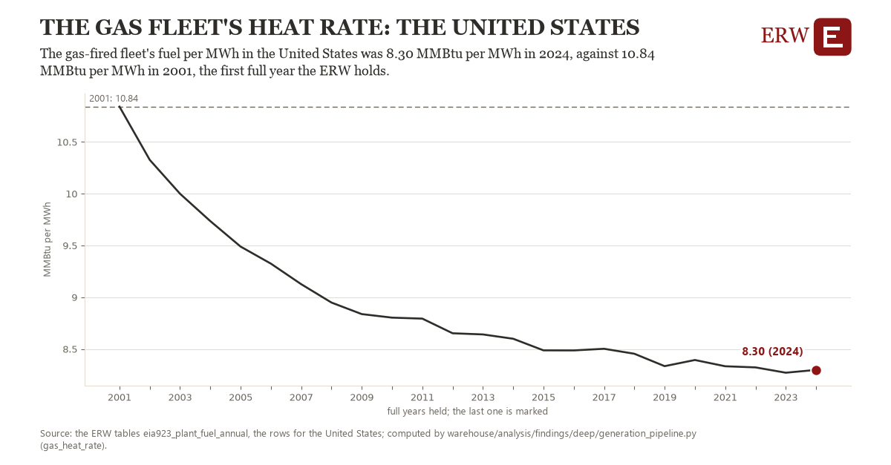

# The gas fleet's heat rate: the United States

Draft `scan-deep-e2d515f4e468` of the findings hunt over the whole warehouse (chain 164), 2026-11-06. State: draft, not reviewed. Review at `/internal/findings`.

**The finding.** The gas-fired fleet's fuel per MWh in the United States was 8.30 MMBtu per MWh in 2024, against 10.84 MMBtu per MWh in 2001, the first full year the ERW holds.

**The figure by full year** (MMBtu per MWh): 2001: 10.84, 2002: 10.33, 2003: 10.00, 2004: 9.73, 2005: 9.49, 2006: 9.32, 2007: 9.13, 2008: 8.95, 2009: 8.84, 2010: 8.80, 2011: 8.79, 2012: 8.65, 2013: 8.64, 2014: 8.60, 2015: 8.49, 2016: 8.49, 2017: 8.50, 2018: 8.45, 2019: 8.33, 2020: 8.39, 2021: 8.33, 2022: 8.32, 2023: 8.27, 2024: 8.30.

**The tables and rows.** `eia923_plant_fuel_annual`; the rows for the United States, region key `hr_gas_US` (the card's `hunt.region`), years 2001 to 2024. The yearly values: `gas-heat-rate-hr-gas-us.csv`.

**Its strength.** The change is 28.40 typical yearly moves (a typical move is 0.09 MMBtu per MWh, 1.4826 times the median absolute change between full years). Holds in more than one year: 23 of the 23 full years after 2001 lie below 2001's value. Survives a change of window: from 2002 to 2024 the change is -2.03, from 2001 to 2023 it is -2.57. Sample large enough: 2001 holds 1 and 2024 holds 1 observations; the floor is 1. Half the change remains without the first year: from 2002 to 2024 the change is -2.03, 79.8 percent of the change from 2001. At least one typical yearly move: the change is 28.40 typical yearly moves (0.09 MMBtu per MWh a year, the median move between full years); the floor is 1.

**Its limits.** EIA-923's total fuel consumed, which at combined heat and power plants includes fuel for their useful heat, so a fleet with more such plants shows a higher figure.

**Reproduce.** `python gas-heat-rate-hr-gas-us.reproduce.py <the table's CSV>` and `do gas-heat-rate-hr-gas-us.reproduce.do` (Stata) recompute the figures by year from the tables as the public downloads hold them; each names the expected values at its top.
