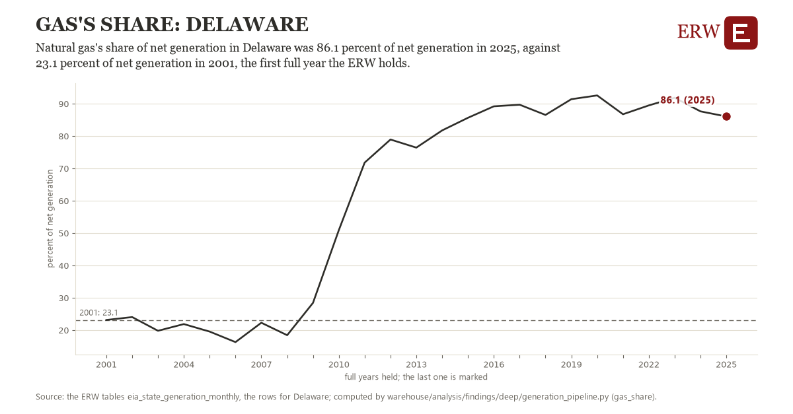

# Gas's share: Delaware

Draft `scan-deep-879dc6e37a47` of the findings hunt over the whole warehouse (chain 164), 2026-11-06. State: draft, not reviewed. Review at `/internal/findings`.

**The finding.** Natural gas's share of net generation in Delaware was 86.1 percent of net generation in 2025, against 23.1 percent of net generation in 2001, the first full year the ERW holds.

**The figure by full year** (percent of net generation): 2001: 23.1, 2002: 24.0, 2003: 19.8, 2004: 21.9, 2005: 19.6, 2006: 16.3, 2007: 22.3, 2008: 18.4, 2009: 28.4, 2010: 50.9, 2011: 71.8, 2012: 78.9, 2013: 76.4, 2014: 81.7, 2015: 85.6, 2016: 89.2, 2017: 89.7, 2018: 86.5, 2019: 91.4, 2020: 92.6, 2021: 86.7, 2022: 89.5, 2023: 91.8, 2024: 87.6, 2025: 86.1.

**The tables and rows.** `eia_state_generation_monthly`; the rows for Delaware, region key `state_ng_DE` (the card's `hunt.region`), years 2001 to 2025. The yearly values: `gas-share-state-ng-de.csv`.

**Its strength.** The change is 11.48 typical yearly moves (a typical move is 5.5 percent of net generation, 1.4826 times the median absolute change between full years). Holds in more than one year: 18 of the 24 full years after 2001 lie above 2001's value. Survives a change of window: from 2002 to 2025 the change is 62.0, from 2001 to 2024 it is 64.5. Sample large enough: 2001 holds 12 and 2025 holds 12 observations; the floor is 11. Half the change remains without the first year: from 2002 to 2025 the change is 62.0, 98.6 percent of the change from 2001. At least one typical yearly move: the change is 11.48 typical yearly moves (5.5 percent of net generation a year, the median move between full years); the floor is 1.

**Its limits.** EIA's monthly net generation as published, the latest months preliminary; a state's share counts what is generated in it, not what is used in it, and EIA withholds some plants' months.

**Reproduce.** `python gas-share-state-ng-de.reproduce.py <the table's CSV>` and `do gas-share-state-ng-de.reproduce.do` (Stata) recompute the figures by year from the tables as the public downloads hold them; each names the expected values at its top.
