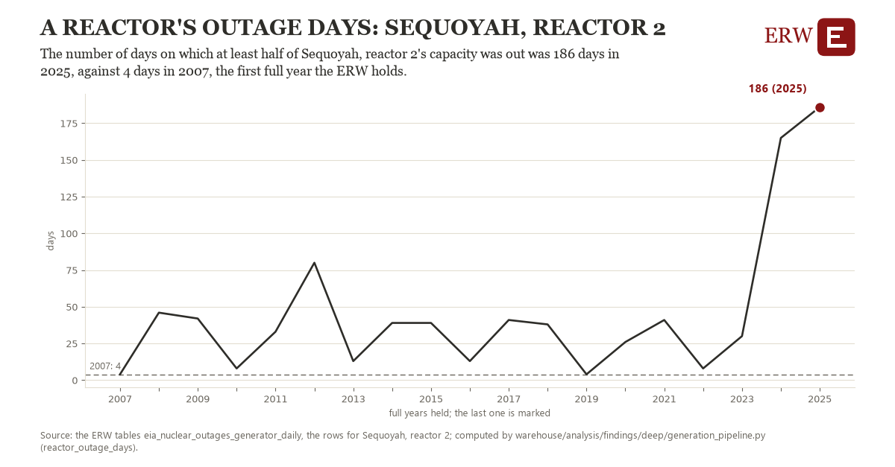

# A reactor's outage days: Sequoyah, reactor 2

Draft `scan-deep-74d24dc0ef94` of the findings hunt over the whole warehouse (chain 164), 2026-11-06. State: draft, not reviewed. Review at `/internal/findings`.

**The finding.** The number of days on which at least half of Sequoyah, reactor 2's capacity was out was 186 days in 2025, against 4 days in 2007, the first full year the ERW holds.

**The figure by full year** (days): 2007: 4, 2008: 46, 2009: 42, 2010: 8, 2011: 33, 2012: 80, 2013: 13, 2014: 39, 2015: 39, 2016: 13, 2017: 41, 2018: 38, 2019: 4, 2020: 26, 2021: 41, 2022: 8, 2023: 30, 2024: 165, 2025: 186.

**The tables and rows.** `eia_nuclear_outages_generator_daily`; the rows for Sequoyah, reactor 2, region key `nuc_6152_2` (the card's `hunt.region`), years 2007 to 2025. The yearly values: `reactor-outage-days-nuc-6152-2.csv`.

**Its strength.** The change is 4.72 typical yearly moves (a typical move is 39 days, 1.4826 times the median absolute change between full years). Holds in more than one year: 17 of the 18 full years after 2007 lie above 2007's value. Survives a change of window: from 2008 to 2025 the change is 140, from 2007 to 2024 it is 161. Sample large enough: 2007 holds 365 and 2025 holds 365 observations; the floor is 330. Half the change remains without the first year: from 2008 to 2025 the change is 140, 76.9 percent of the change from 2007. At least one typical yearly move: the change is 4.72 typical yearly moves (39 days a year, the median move between full years); the floor is 1.

**Its limits.** EIA's daily estimate; refuelling outages fall every 18 or 24 months, so a reactor's years alternate, and the measure counts planned and forced days alike; only reactors that report all of 2007 and 2025 are counted.

**Reproduce.** `python reactor-outage-days-nuc-6152-2.reproduce.py <the table's CSV>` and `do reactor-outage-days-nuc-6152-2.reproduce.do` (Stata) recompute the figures by year from the tables as the public downloads hold them; each names the expected values at its top.
