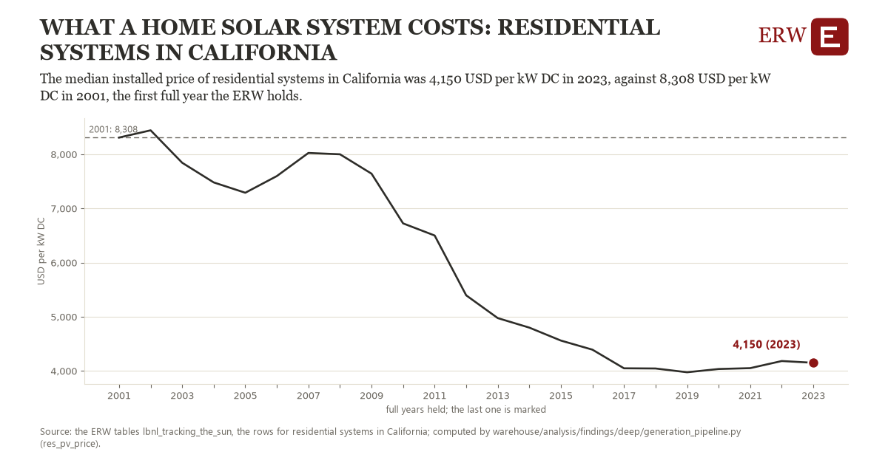

# What a home solar system costs: residential systems in California

Draft `scan-deep-af2dc7748c3c` of the findings hunt over the whole warehouse (chain 164), 2026-11-06. State: draft, not reviewed. Review at `/internal/findings`.

**The finding.** The median installed price of residential systems in California was 4,150 USD per kW DC in 2023, against 8,308 USD per kW DC in 2001, the first full year the ERW holds.

**The figure by full year** (USD per kW DC): 2001: 8,308, 2002: 8,442, 2003: 7,843, 2004: 7,480, 2005: 7,289, 2006: 7,597, 2007: 8,024, 2008: 8,000, 2009: 7,642, 2010: 6,724, 2011: 6,500, 2012: 5,395, 2013: 4,975, 2014: 4,799, 2015: 4,560, 2016: 4,392, 2017: 4,048, 2018: 4,045, 2019: 3,975, 2020: 4,035, 2021: 4,051, 2022: 4,182, 2023: 4,150.

**The tables and rows.** `lbnl_tracking_the_sun`; the rows for residential systems in California, region key `tts_res_CA` (the card's `hunt.region`), years 2001 to 2023. The yearly values: `res-pv-price-tts-res-ca.csv`.

**Its strength.** The change is 13.54 typical yearly moves (a typical move is 307 USD per kW DC, 1.4826 times the median absolute change between full years). Holds in more than one year: 21 of the 22 full years after 2001 lie below 2001's value. Survives a change of window: from 2002 to 2023 the change is -4,292, from 2001 to 2022 it is -4,126. Sample large enough: 2001 holds 1 and 2023 holds 1 observations; the floor is 1. Half the change remains without the first year: from 2002 to 2023 the change is -4,292, 103.2 percent of the change from 2001. At least one typical yearly move: the change is 13.54 typical yearly moves (307 USD per kW DC a year, the median move between full years); the floor is 1.

**Its limits.** Nominal dollars; the ERW's unscreened median over the systems Berkeley Lab lists with a price, not Berkeley Lab's reported figure; a year with fewer than 500 priced systems is left out.

**Reproduce.** `python res-pv-price-tts-res-ca.reproduce.py <the table's CSV>` and `do res-pv-price-tts-res-ca.reproduce.do` (Stata) recompute the figures by year from the tables as the public downloads hold them; each names the expected values at its top.
