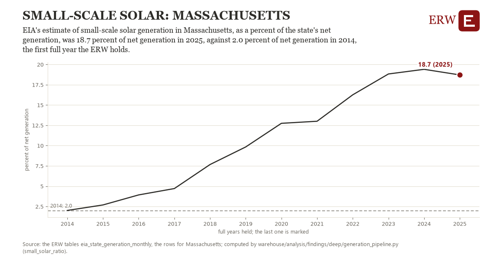

# Small-scale solar: Massachusetts

Draft `scan-deep-bb58cb4d30cb` of the findings hunt over the whole warehouse (chain 164), 2026-11-06. State: draft, not reviewed. Review at `/internal/findings`.

**The finding.** EIA's estimate of small-scale solar generation in Massachusetts, as a percent of the state's net generation, was 18.7 percent of net generation in 2025, against 2.0 percent of net generation in 2014, the first full year the ERW holds.

**The figure by full year** (percent of net generation): 2014: 2.0, 2015: 2.7, 2016: 3.9, 2017: 4.7, 2018: 7.7, 2019: 9.8, 2020: 12.7, 2021: 13.0, 2022: 16.3, 2023: 18.8, 2024: 19.4, 2025: 18.7.

**The tables and rows.** `eia_state_generation_monthly`; the rows for Massachusetts, region key `state_dpv_MA` (the card's `hunt.region`), years 2014 to 2025. The yearly values: `small-solar-ratio-state-dpv-ma.csv`.

**Its strength.** The change is 9.12 typical yearly moves (a typical move is 1.8 percent of net generation, 1.4826 times the median absolute change between full years). Holds in more than one year: 11 of the 11 full years after 2014 lie above 2014's value. Survives a change of window: from 2015 to 2025 the change is 16.0, from 2014 to 2024 it is 17.4. Sample large enough: 2014 holds 12 and 2025 holds 12 observations; the floor is 11. Half the change remains without the first year: from 2015 to 2025 the change is 16.0, 95.9 percent of the change from 2014. At least one typical yearly move: the change is 9.12 typical yearly moves (1.8 percent of net generation a year, the median move between full years); the floor is 1.

**Its limits.** An estimate EIA models from capacity, not a metered figure, and set against a total that does not include it.

**Reproduce.** `python small-solar-ratio-state-dpv-ma.reproduce.py <the table's CSV>` and `do small-solar-ratio-state-dpv-ma.reproduce.do` (Stata) recompute the figures by year from the tables as the public downloads hold them; each names the expected values at its top.
