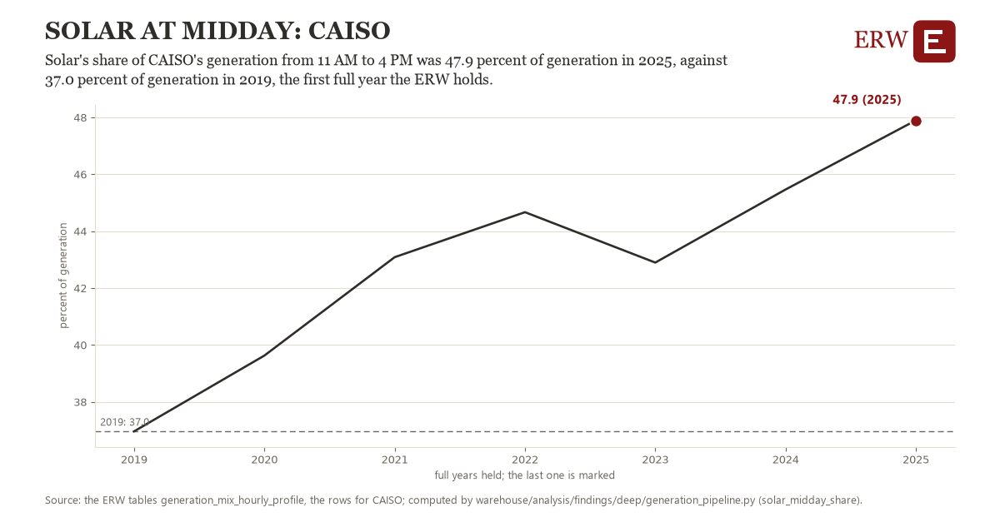

# Solar at midday: CAISO

Draft `scan-deep-42891ac362d0` of the findings hunt over the whole warehouse (chain 164), 2026-11-06. State: draft, not reviewed. Review at `/internal/findings`.

**The finding.** Solar's share of CAISO's generation from 11 AM to 4 PM was 47.9 percent of generation in 2025, against 37.0 percent of generation in 2019, the first full year the ERW holds.

**The figure by full year** (percent of generation): 2019: 37.0, 2020: 39.6, 2021: 43.1, 2022: 44.7, 2023: 42.9, 2024: 45.5, 2025: 47.9.

**The tables and rows.** `generation_mix_hourly_profile`; the rows for CAISO, region key `caiso_mix` (the card's `hunt.region`), years 2019 to 2025. The yearly values: `solar-midday-share-caiso-mix.csv`.

**Its strength.** The change is 2.95 typical yearly moves (a typical move is 3.7 percent of generation, 1.4826 times the median absolute change between full years). Holds in more than one year: 6 of the 6 full years after 2019 lie above 2019's value. Survives a change of window: from 2020 to 2025 the change is 8.3, from 2019 to 2024 it is 8.5. Sample large enough: 2019 holds 11 and 2025 holds 11 observations; the floor is 11. Half the change remains without the first year: from 2020 to 2025 the change is 8.3, 75.6 percent of the change from 2019. At least one typical yearly move: the change is 2.95 typical yearly moves (3.7 percent of generation a year, the median move between full years); the floor is 1.

**Its limits.** EIA-930 hourly generation as the ERW's monthly profile holds it; a month is the mean of its complete days, and behind-the-meter solar is not in it.

**Reproduce.** `python solar-midday-share-caiso-mix.reproduce.py <the table's CSV>` and `do solar-midday-share-caiso-mix.reproduce.do` (Stata) recompute the figures by year from the tables as the public downloads hold them; each names the expected values at its top.
