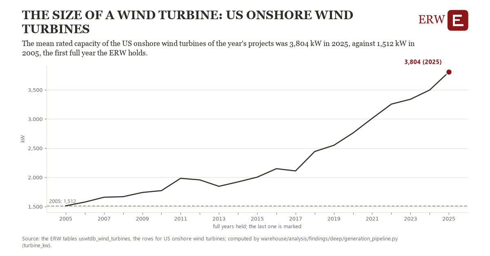

# The size of a wind turbine: US onshore wind turbines

Draft `scan-deep-ca16b8ec9d96` of the findings hunt over the whole warehouse (chain 164), 2026-11-06. State: draft, not reviewed. Review at `/internal/findings`.

**The finding.** The mean rated capacity of the US onshore wind turbines of the year's projects was 3,804 kW in 2025, against 1,512 kW in 2005, the first full year the ERW holds.

**The figure by full year** (kW): 2005: 1,512, 2006: 1,577, 2007: 1,660, 2008: 1,669, 2009: 1,741, 2010: 1,773, 2011: 1,984, 2012: 1,957, 2013: 1,847, 2014: 1,923, 2015: 2,004, 2016: 2,149, 2017: 2,111, 2018: 2,443, 2019: 2,550, 2020: 2,760, 2021: 3,011, 2022: 3,255, 2023: 3,339, 2024: 3,496, 2025: 3,804.

**The tables and rows.** `uswtdb_wind_turbines`; the rows for US onshore wind turbines, region key `us_turbine_kw` (the card's `hunt.region`), years 2005 to 2025. The yearly values: `turbine-kw-us-turbine-kw.csv`.

**Its strength.** The change is 16.20 typical yearly moves (a typical move is 142 kW, 1.4826 times the median absolute change between full years). Holds in more than one year: 20 of the 20 full years after 2005 lie above 2005's value. Survives a change of window: from 2006 to 2025 the change is 2,228, from 2005 to 2024 it is 1,984. Sample large enough: 2005 holds 1 and 2025 holds 1 observations; the floor is 1. Half the change remains without the first year: from 2006 to 2025 the change is 2,228, 97.2 percent of the change from 2005. At least one typical yearly move: the change is 16.20 typical yearly moves (142 kW a year, the median move between full years); the floor is 1.

**Its limits.** The US Wind Turbine Database's project year and turbine rating; turbines without a rating are left out, and repowered turbines keep their project's year.

**Reproduce.** `python turbine-kw-us-turbine-kw.reproduce.py <the table's CSV>` and `do turbine-kw-us-turbine-kw.reproduce.do` (Stata) recompute the figures by year from the tables as the public downloads hold them; each names the expected values at its top.
