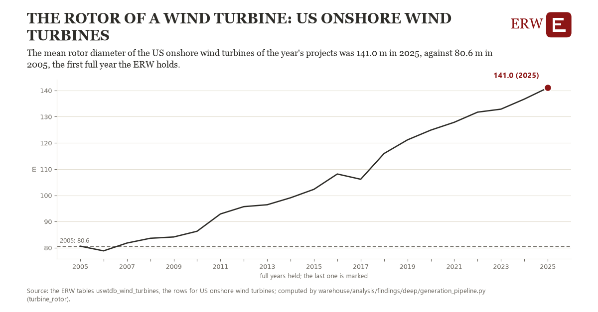

# The rotor of a wind turbine: US onshore wind turbines

Draft `scan-deep-4dd4f313b2f6` of the findings hunt over the whole warehouse (chain 164), 2026-11-06. State: draft, not reviewed. Review at `/internal/findings`.

**The finding.** The mean rotor diameter of the US onshore wind turbines of the year's projects was 141.0 m in 2025, against 80.6 m in 2005, the first full year the ERW holds.

**The figure by full year** (m): 2005: 80.6, 2006: 78.8, 2007: 81.8, 2008: 83.6, 2009: 84.1, 2010: 86.3, 2011: 92.9, 2012: 95.7, 2013: 96.4, 2014: 99.1, 2015: 102.3, 2016: 108.1, 2017: 106.1, 2018: 116.0, 2019: 121.2, 2020: 124.9, 2021: 127.9, 2022: 131.7, 2023: 132.9, 2024: 136.7, 2025: 141.0.

**The tables and rows.** `uswtdb_wind_turbines`; the rows for US onshore wind turbines, region key `us_turbine_rotor` (the card's `hunt.region`), years 2005 to 2025. The yearly values: `turbine-rotor-us-turbine-rotor.csv`.

**Its strength.** The change is 13.69 typical yearly moves (a typical move is 4.4 m, 1.4826 times the median absolute change between full years). Holds in more than one year: 19 of the 20 full years after 2005 lie above 2005's value. Survives a change of window: from 2006 to 2025 the change is 62.2, from 2005 to 2024 it is 56.1. Sample large enough: 2005 holds 1 and 2025 holds 1 observations; the floor is 1. Half the change remains without the first year: from 2006 to 2025 the change is 62.2, 103.0 percent of the change from 2005. At least one typical yearly move: the change is 13.69 typical yearly moves (4.4 m a year, the median move between full years); the floor is 1.

**Its limits.** The US Wind Turbine Database's project year and rotor diameter; turbines without a diameter are left out.

**Reproduce.** `python turbine-rotor-us-turbine-rotor.reproduce.py <the table's CSV>` and `do turbine-rotor-us-turbine-rotor.reproduce.do` (Stata) recompute the figures by year from the tables as the public downloads hold them; each names the expected values at its top.
