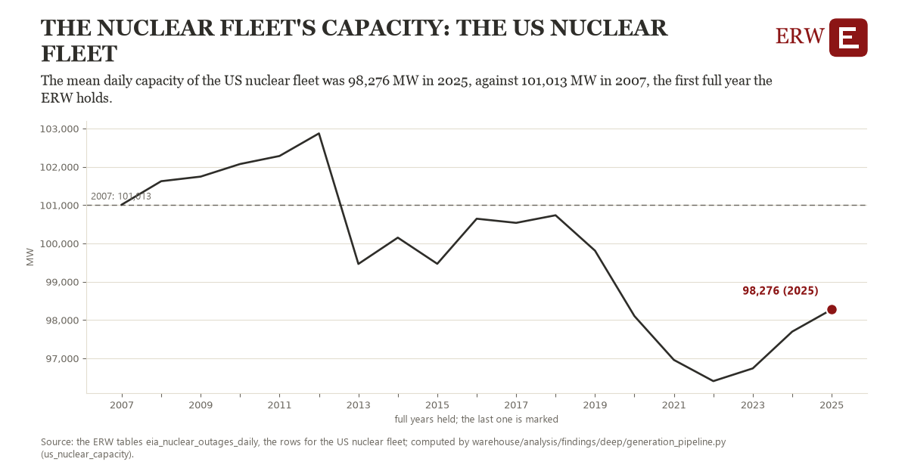

# The nuclear fleet's capacity: the US nuclear fleet

Draft `scan-deep-4fcc17900596` of the findings hunt over the whole warehouse (chain 164), 2026-11-06. State: draft, not reviewed. Review at `/internal/findings`.

**The finding.** The mean daily capacity of the US nuclear fleet was 98,276 MW in 2025, against 101,013 MW in 2007, the first full year the ERW holds.

**The figure by full year** (MW): 2007: 101,013, 2008: 101,625, 2009: 101,744, 2010: 102,073, 2011: 102,283, 2012: 102,872, 2013: 99,465, 2014: 100,152, 2015: 99,469, 2016: 100,645, 2017: 100,537, 2018: 100,735, 2019: 99,811, 2020: 98,103, 2021: 96,959, 2022: 96,406, 2023: 96,738, 2024: 97,698, 2025: 98,276.

**The tables and rows.** `eia_nuclear_outages_daily`; the rows for the US nuclear fleet, region key `us_nuclear_cap` (the card's `hunt.region`), years 2007 to 2025. The yearly values: `us-nuclear-capacity-us-nuclear-cap.csv`.

**Its strength.** The change is 3.08 typical yearly moves (a typical move is 890 MW, 1.4826 times the median absolute change between full years). Holds in more than one year: 13 of the 18 full years after 2007 lie below 2007's value. Survives a change of window: from 2008 to 2025 the change is -3,349, from 2007 to 2024 it is -3,315. Sample large enough: 2007 holds 365 and 2025 holds 365 observations; the floor is 330. Half the change remains without the first year: from 2008 to 2025 the change is -3,349, 122.3 percent of the change from 2007. At least one typical yearly move: the change is 3.08 typical yearly moves (890 MW a year, the median move between full years); the floor is 1.

**Its limits.** EIA's capacity as used for its outage estimate; it moves with retirements, new reactors and uprates together, and the measure does not separate them.

**Reproduce.** `python us-nuclear-capacity-us-nuclear-cap.reproduce.py <the table's CSV>` and `do us-nuclear-capacity-us-nuclear-cap.reproduce.do` (Stata) recompute the figures by year from the tables as the public downloads hold them; each names the expected values at its top.
