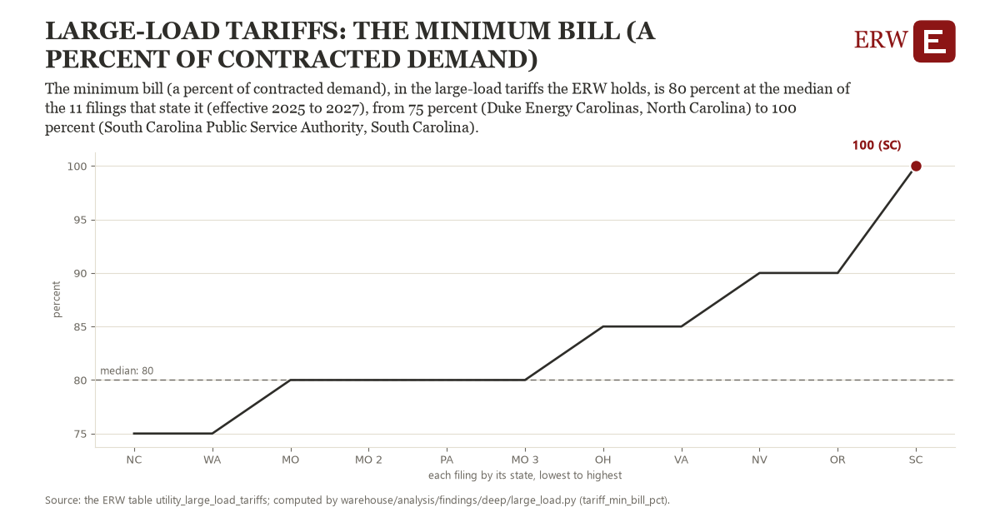

# Large-load tariffs: the minimum bill (a percent of contracted demand)

Draft `scan-deep-52742c0dd6c4` of the findings hunt (chain 502), 2026-11-19. State: draft, not reviewed. Review at `/internal/findings`.

**The finding.** The minimum bill (a percent of contracted demand), in the large-load tariffs the ERW holds, is 80 percent at the median of the 11 filings that state it (effective 2025 to 2027), from 75 percent (Duke Energy Carolinas, North Carolina) to 100 percent (South Carolina Public Service Authority, South Carolina).

**The tables and rows.** `utility_large_load_tariffs`; the rows in `tariff-min-bill-pct.csv`.

**Its strength.** At least five filings: 11 filings state it. Every figure cites its document: 11 of 11 name their document and page. One unit: unit pct. The median holds without the lowest and highest filing: the median without them is 80, against 80. No utility counted twice: 11 utilities in 11 filings.

**Its limits.** The tariffs the ERW has read and recorded, filed, proposed or adopted, not every utility's; a term is as the tariff prints it, and two tariffs may measure it from different starts (a ramp period, the first bill).

**Reproduce.** `python tariff-min-bill-pct.reproduce.py <utility_large_load_tariffs.csv>` and `do tariff-min-bill-pct.reproduce.do` (Stata) print the figures named at their top.
