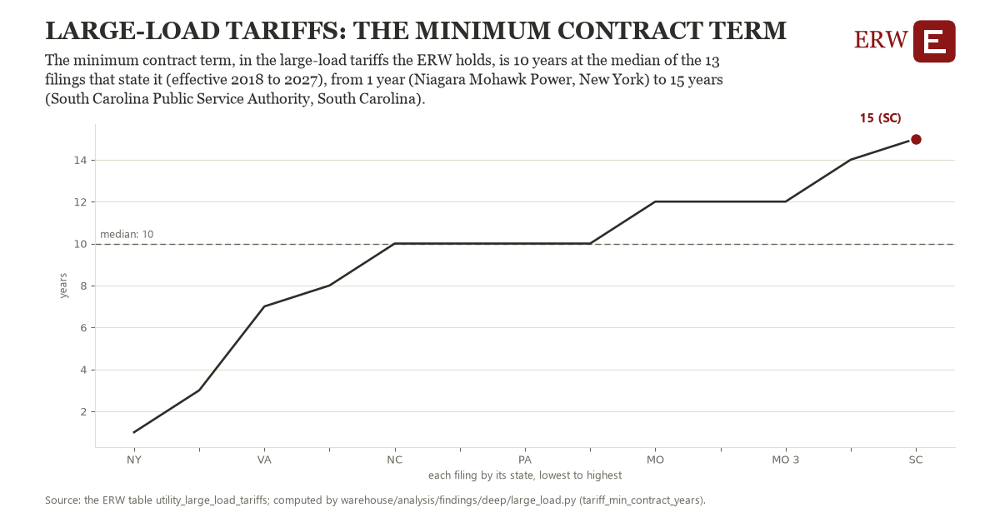

# Large-load tariffs: the minimum contract term

Draft `scan-deep-035a684f6018` of the findings hunt (chain 502), 2026-11-19. State: draft, not reviewed. Review at `/internal/findings`.

**The finding.** The minimum contract term, in the large-load tariffs the ERW holds, is 10 years at the median of the 13 filings that state it (effective 2018 to 2027), from 1 year (Niagara Mohawk Power, New York) to 15 years (South Carolina Public Service Authority, South Carolina).

**The tables and rows.** `utility_large_load_tariffs`; the rows in `tariff-min-contract-years.csv`.

**Its strength.** At least five filings: 13 filings state it. Every figure cites its document: 13 of 13 name their document and page. One unit: unit year. The median holds without the lowest and highest filing: the median without them is 10, against 10. No utility counted twice: 13 utilities in 13 filings.

**Its limits.** The tariffs the ERW has read and recorded, filed, proposed or adopted, not every utility's; a term is as the tariff prints it, and two tariffs may measure it from different starts (a ramp period, the first bill).

**Reproduce.** `python tariff-min-contract-years.reproduce.py <utility_large_load_tariffs.csv>` and `do tariff-min-contract-years.reproduce.do` (Stata) print the figures named at their top.
