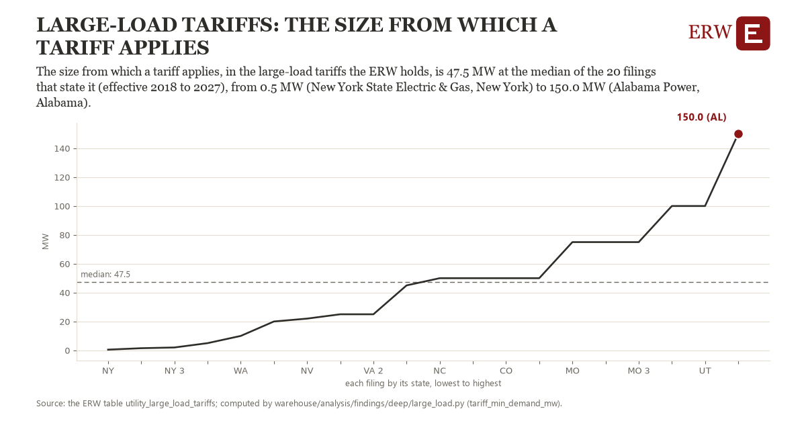

# Large-load tariffs: the size from which a tariff applies

Draft `scan-deep-bddcaa827f30` of the findings hunt (chain 502), 2026-11-19. State: draft, not reviewed. Review at `/internal/findings`.

**The finding.** The size from which a tariff applies, in the large-load tariffs the ERW holds, is 47.5 MW at the median of the 20 filings that state it (effective 2018 to 2027), from 0.5 MW (New York State Electric & Gas, New York) to 150.0 MW (Alabama Power, Alabama).

**The tables and rows.** `utility_large_load_tariffs`; the rows in `tariff-min-demand-mw.csv`.

**Its strength.** At least five filings: 20 filings state it. Every figure cites its document: 20 of 20 name their document and page. One unit: unit MW. The median holds without the lowest and highest filing: the median without them is 47.5, against 47.5. No utility counted twice: 20 utilities in 20 filings.

**Its limits.** The tariffs the ERW has read and recorded, filed, proposed or adopted, not every utility's; a term is as the tariff prints it, and two tariffs may measure it from different starts (a ramp period, the first bill).

**Reproduce.** `python tariff-min-demand-mw.reproduce.py <utility_large_load_tariffs.csv>` and `do tariff-min-demand-mw.reproduce.do` (Stata) print the figures named at their top.
