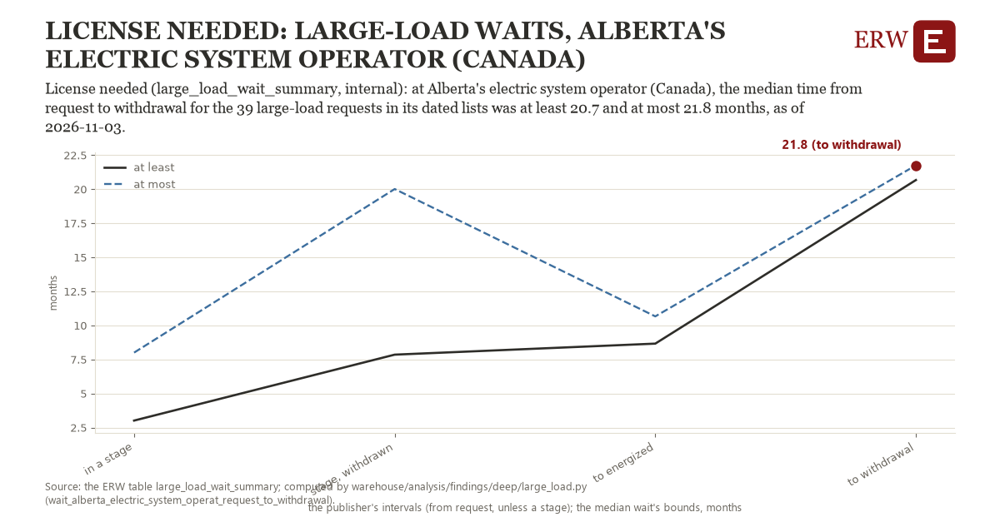

# License needed: large-load waits, alberta's electric system operator (canada)

Draft `scan-deep-2933c5f2e98d` of the findings hunt (chain 502), 2026-11-19. State: draft, not reviewed. Review at `/internal/findings`.

**The finding.** License needed (large_load_wait_summary, internal): at Alberta's electric system operator (Canada), the median time from request to withdrawal for the 39 large-load requests in its dated lists was at least 20.7 and at most 21.8 months, as of 2026-11-03.

**The tables and rows.** `large_load_wait_summary` (internal: license needed); the rows in `wait-alberta-electric-system-operat-request-to-withdrawal.csv`.

**Its strength.** At least 20 requests: 39 requests in the interval. At least 5 measured between dated copies: 37 measured. The bounds ordered: at least 20.7, at most 21.8 months. The median bounded on both sides: both bounds held. Requests still waiting counted apart: 0 requests are lower bounds only.

**Its limits.** Bounds, not a figure: a request's wait is known only between the dated copies of the publisher's list that show it, and a request still waiting gives only a lower bound; the publisher's terms keep the table internal.

**Reproduce.** `python wait-alberta-electric-system-operat-request-to-withdrawal.reproduce.py <large_load_wait_summary.csv>` and `do wait-alberta-electric-system-operat-request-to-withdrawal.reproduce.do` (Stata) print the figures named at their top.
