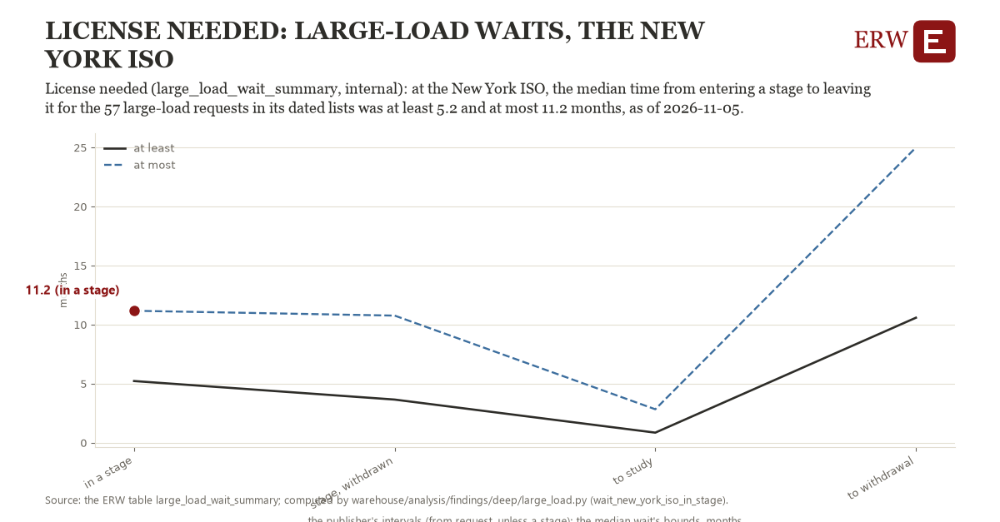

# License needed: large-load waits, the new york iso

Draft `scan-deep-a6939e956936` of the findings hunt (chain 502), 2026-11-19. State: draft, not reviewed. Review at `/internal/findings`.

**The finding.** License needed (large_load_wait_summary, internal): at the New York ISO, the median time from entering a stage to leaving it for the 57 large-load requests in its dated lists was at least 5.2 and at most 11.2 months, as of 2026-11-05.

**The tables and rows.** `large_load_wait_summary` (internal: license needed); the rows in `wait-new-york-iso-in-stage.csv`.

**Its strength.** At least 20 requests: 57 requests in the interval. At least 5 measured between dated copies: 47 measured. The bounds ordered: at least 5.2, at most 11.2 months. The median bounded on both sides: both bounds held. Requests still waiting counted apart: 53 requests are lower bounds only.

**Its limits.** Bounds, not a figure: a request's wait is known only between the dated copies of the publisher's list that show it, and a request still waiting gives only a lower bound; the publisher's terms keep the table internal.

**Reproduce.** `python wait-new-york-iso-in-stage.reproduce.py <large_load_wait_summary.csv>` and `do wait-new-york-iso-in-stage.reproduce.do` (Stata) print the figures named at their top.
