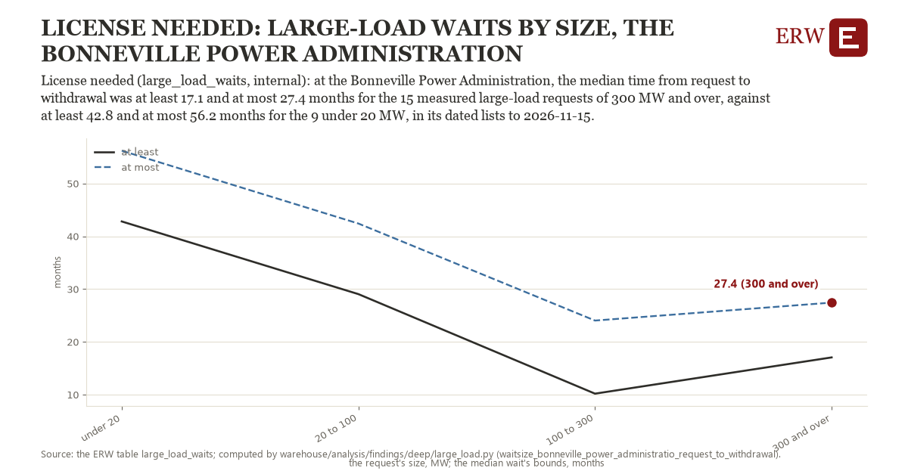

# License needed: large-load waits by size, the bonneville power administration

Draft `scan-deep-7dd3aeae0971` of the findings hunt (chain 502), 2026-11-19. State: draft, not reviewed. Review at `/internal/findings`.

**The finding.** License needed (large_load_waits, internal): at the Bonneville Power Administration, the median time from request to withdrawal was at least 17.1 and at most 27.4 months for the 15 measured large-load requests of 300 MW and over, against at least 42.8 and at most 56.2 months for the 9 under 20 MW, in its dated lists to 2026-11-15.

**The tables and rows.** `large_load_waits` (internal: license needed); the rows in `waitsize-bonneville-power-administratio-request-to-withdrawal.csv`.

**Its strength.** Five or more measured in each class: 15 of 300 MW and over, 9 under 20 MW. Each range ordered: the shorter end below the longer in both. The two ranges do not overlap: 300 MW and over: 17.1 to 27.4 months; under 20 MW: 42.8 to 56.2. The next class lies on the same side: 20 to under 100 MW: 29.0 to 42.4 months. Requests still waiting are not in the medians: lower bounds and two-copy requests are counted apart, as in the summary.

**Its limits.** Bounds, not figures: a request's wait is known only between the dated copies that show it; the size is the request's first megawatts as printed; the publisher's terms keep the table internal; no request is named.

**Reproduce.** `python waitsize-bonneville-power-administratio-request-to-withdrawal.reproduce.py <large_load_waits.csv>` and `do waitsize-bonneville-power-administratio-request-to-withdrawal.reproduce.do` (Stata) print the figures named at their top.
