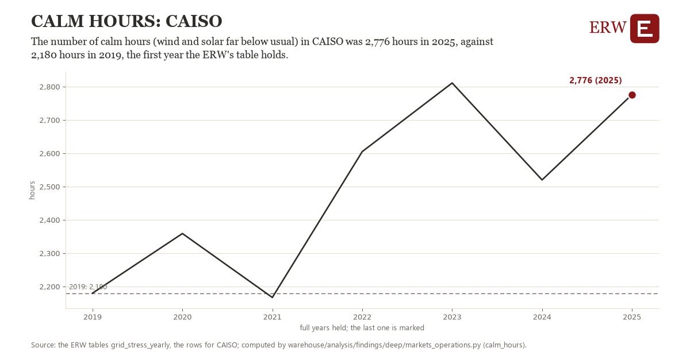

# Calm hours: CAISO

Draft `scan-deep-140097c6934a` of the findings hunt over the whole warehouse (chain 164), 2026-11-06. State: draft, not reviewed. Review at `/internal/findings`.

**The finding.** The number of calm hours (wind and solar far below usual) in CAISO was 2,776 hours in 2025, against 2,180 hours in 2019, the first year the ERW's table holds.

**The figure by full year** (hours): 2019: 2,180, 2020: 2,359, 2021: 2,167, 2022: 2,605, 2023: 2,811, 2024: 2,520, 2025: 2,776.

**The tables and rows.** `grid_stress_yearly`; the rows for CAISO, region key `caiso_calm_hours` (the card's `hunt.region`), years 2019 to 2025. The yearly values: `calm-hours-caiso-calm-hours.csv`.

**Its strength.** The change is 1.74 typical yearly moves (a typical move is 342 hours, 1.4826 times the median absolute change between full years). Holds in more than one year: 5 of the 6 full years after 2019 lie above 2019's value. Survives a change of window: from 2020 to 2025 the change is 417, from 2019 to 2024 it is 340. Sample large enough: 2019 holds 1 and 2025 holds 1 observations; the floor is 1. Half the change remains without the first year: from 2020 to 2025 the change is 417, 70.0 percent of the change from 2019. At least one typical yearly move: the change is 1.74 typical yearly moves (342 hours a year, the median move between full years); the floor is 1.

**Its limits.** The ERW's derived grid_stress_yearly (EIA-930 hourly by source, EIA's generator inventory); the tightest hours are the year's hours of highest net load, and a grid whose capacity grew late in a year shows a share of a capacity it held only in part. Weather moves the count from year to year.

**Reproduce.** `python calm-hours-caiso-calm-hours.reproduce.py <the table's CSV>` and `do calm-hours-caiso-calm-hours.reproduce.do` (Stata) recompute the figures by year from the tables as the public downloads hold them; each names the expected values at its top.
