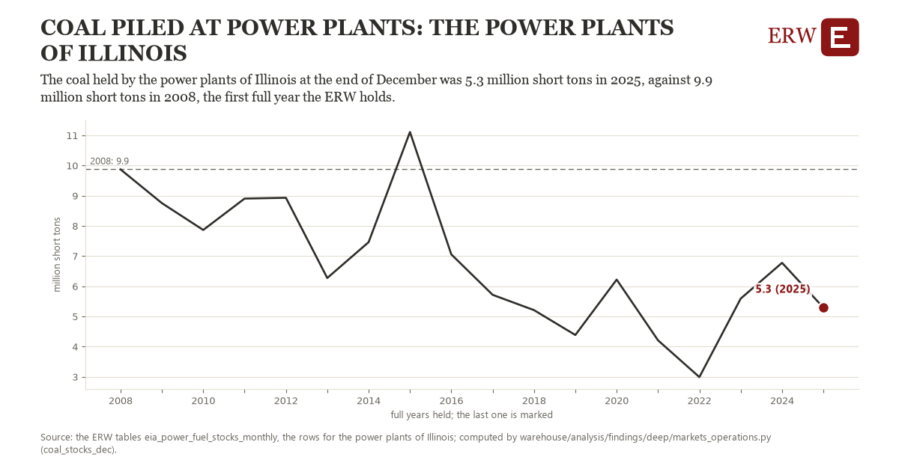

# Coal piled at power plants: the power plants of Illinois

Draft `scan-deep-59529a3fa91e` of the findings hunt over the whole warehouse (chain 502), 2026-11-19. State: draft, not reviewed. Review at `/internal/findings`.

**The finding.** The coal held by the power plants of Illinois at the end of December was 5.3 million short tons in 2025, against 9.9 million short tons in 2008, the first full year the ERW holds.

**The figure by full year** (million short tons): 2008: 9.9, 2009: 8.8, 2010: 7.9, 2011: 8.9, 2012: 8.9, 2013: 6.3, 2014: 7.5, 2015: 11.1, 2016: 7.1, 2017: 5.7, 2018: 5.2, 2019: 4.4, 2020: 6.2, 2021: 4.2, 2022: 3.0, 2023: 5.6, 2024: 6.8, 2025: 5.3.

**The tables and rows.** `eia_power_fuel_stocks_monthly`; the rows for the power plants of Illinois, region key `cst_il` (the card's `hunt.region`), years 2008 to 2025. The yearly values: `coal-stocks-dec-cst-il.csv`.

**Its strength.** The change is 2.54 typical yearly moves (a typical move is 1.8 million short tons, 1.4826 times the median absolute change between full years). Holds in more than one year: 16 of the 17 full years after 2008 lie below 2008's value. Survives a change of window: from 2009 to 2025 the change is -3.5, from 2008 to 2024 it is -3.1. Sample large enough: 2008 holds 1 and 2025 holds 1 observations; the floor is 1. Half the change remains without the first year: from 2009 to 2025 the change is -3.5, 75.6 percent of the change from 2008. At least one typical yearly move: the change is 2.54 typical yearly moves (1.8 million short tons a year, the median move between full years); the floor is 1.

**Its limits.** EIA's stocks at power plants of the electric power sector (code 98), coal excluding waste coal, at the end of December.

**Reproduce.** `python coal-stocks-dec-cst-il.reproduce.py <the table's CSV>` and `do coal-stocks-dec-cst-il.reproduce.do` (Stata) recompute the figures by year from the tables as the public downloads hold them; each names the expected values at its top.
