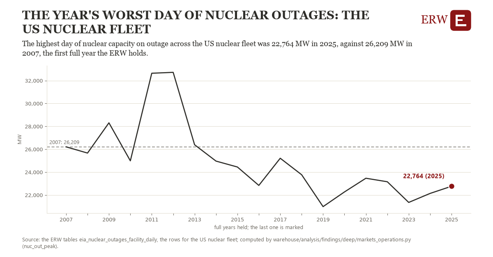

# The year's worst day of nuclear outages: the US nuclear fleet

Draft `scan-deep-d91fa27e95e0` of the findings hunt over the whole warehouse (chain 502), 2026-11-19. State: draft, not reviewed. Review at `/internal/findings`.

**The finding.** The highest day of nuclear capacity on outage across the US nuclear fleet was 22,764 MW in 2025, against 26,209 MW in 2007, the first full year the ERW holds.

**The figure by full year** (MW): 2007: 26,209, 2008: 25,665, 2009: 28,308, 2010: 24,988, 2011: 32,640, 2012: 32,720, 2013: 26,392, 2014: 24,964, 2015: 24,447, 2016: 22,839, 2017: 25,213, 2018: 23,771, 2019: 20,984, 2020: 22,269, 2021: 23,465, 2022: 23,158, 2023: 21,352, 2024: 22,140, 2025: 22,764.

**The tables and rows.** `eia_nuclear_outages_facility_daily`; the rows for the US nuclear fleet, region key `nuc_us` (the card's `hunt.region`), years 2007 to 2025. The yearly values: `nuc-out-peak-nuc-us.csv`.

**Its strength.** The change is 1.62 typical yearly moves (a typical move is 2,127 MW, 1.4826 times the median absolute change between full years). Holds in more than one year: 14 of the 18 full years after 2007 lie below 2007's value. Survives a change of window: from 2008 to 2025 the change is -2,901, from 2007 to 2024 it is -4,069. Sample large enough: 2007 holds 365 and 2025 holds 365 observations; the floor is 330. Half the change remains without the first year: from 2008 to 2025 the change is -2,901, 84.2 percent of the change from 2007. At least one typical yearly move: the change is 1.62 typical yearly moves (2,127 MW a year, the median move between full years); the floor is 1.

**Its limits.** EIA's daily nuclear outages by facility, as EIA compiles them from the NRC's daily status; a facility's capacity is as EIA lists it that day; a year's days are those every facility row holds.

**Reproduce.** `python nuc-out-peak-nuc-us.reproduce.py <the table's CSV>` and `do nuc-out-peak-nuc-us.reproduce.do` (Stata) recompute the figures by year from the tables as the public downloads hold them; each names the expected values at its top.
