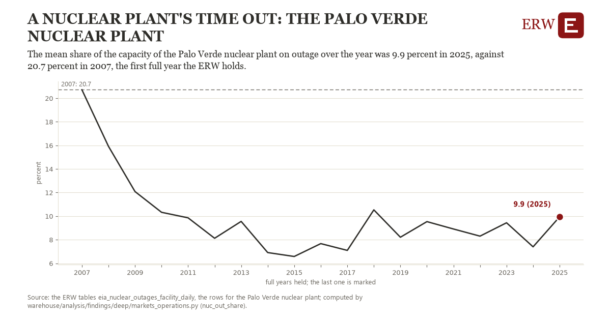

# A nuclear plant's time out: the Palo Verde nuclear plant

Draft `scan-deep-5e34cba13e22` of the findings hunt over the whole warehouse (chain 502), 2026-11-19. State: draft, not reviewed. Review at `/internal/findings`.

**The finding.** The mean share of the capacity of the Palo Verde nuclear plant on outage over the year was 9.9 percent in 2025, against 20.7 percent in 2007, the first full year the ERW holds.

**The figure by full year** (percent): 2007: 20.7, 2008: 15.9, 2009: 12.1, 2010: 10.3, 2011: 9.9, 2012: 8.1, 2013: 9.6, 2014: 6.9, 2015: 6.6, 2016: 7.7, 2017: 7.1, 2018: 10.5, 2019: 8.2, 2020: 9.5, 2021: 8.9, 2022: 8.3, 2023: 9.4, 2024: 7.4, 2025: 9.9.

**The tables and rows.** `eia_nuclear_outages_facility_daily`; the rows for the Palo Verde nuclear plant, region key `nucf_6008` (the card's `hunt.region`), years 2007 to 2025. The yearly values: `nuc-out-share-nucf-6008.csv`.

**Its strength.** The change is 4.59 typical yearly moves (a typical move is 2.3 percent, 1.4826 times the median absolute change between full years). Holds in more than one year: 18 of the 18 full years after 2007 lie below 2007's value. Survives a change of window: from 2008 to 2025 the change is -6.0, from 2007 to 2024 it is -13.3. Sample large enough: 2007 holds 365 and 2025 holds 365 observations; the floor is 330. Half the change remains without the first year: from 2008 to 2025 the change is -6.0, 55.5 percent of the change from 2007. At least one typical yearly move: the change is 4.59 typical yearly moves (2.3 percent a year, the median move between full years); the floor is 1.

**Its limits.** EIA's daily nuclear outages by facility, as EIA compiles them from the NRC's daily status; a facility's capacity is as EIA lists it that day; a year's days are those every facility row holds.

**Reproduce.** `python nuc-out-share-nucf-6008.reproduce.py <the table's CSV>` and `do nuc-out-share-nucf-6008.reproduce.do` (Stata) recompute the figures by year from the tables as the public downloads hold them; each names the expected values at its top.
