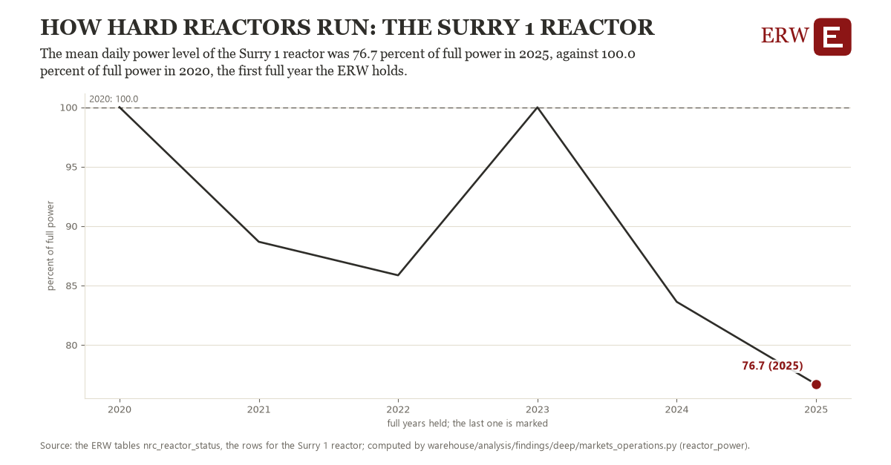

# How hard reactors run: the Surry 1 reactor

Draft `scan-deep-177cacb373f4` of the findings hunt over the whole warehouse (chain 502), 2026-11-19. State: draft, not reviewed. Review at `/internal/findings`.

**The finding.** The mean daily power level of the Surry 1 reactor was 76.7 percent of full power in 2025, against 100.0 percent of full power in 2020, the first full year the ERW holds.

**The figure by full year** (percent of full power): 2020: 100.0, 2021: 88.7, 2022: 85.9, 2023: 100.0, 2024: 83.6, 2025: 76.7.

**The tables and rows.** `nrc_reactor_status`; the rows for the Surry 1 reactor, region key `rp_surry_1` (the card's `hunt.region`), years 2020 to 2025. The yearly values: `reactor-power-rp-surry-1.csv`.

**Its strength.** The change is 1.39 typical yearly moves (a typical move is 16.8 percent of full power, 1.4826 times the median absolute change between full years). Holds in more than one year: 5 of the 5 full years after 2020 lie below 2020's value. Survives a change of window: from 2021 to 2025 the change is -12.0, from 2020 to 2024 it is -16.4. Sample large enough: 2020 holds 366 and 2025 holds 365 observations; the floor is 330. Half the change remains without the first year: from 2021 to 2025 the change is -12.0, 51.4 percent of the change from 2020. At least one typical yearly move: the change is 1.39 typical yearly moves (16.8 percent of full power a year, the median move between full years); the floor is 1.

**Its limits.** The NRC's daily power reactor status as reported each morning; a reactor's day at 0 percent counts, a shut reactor leaves the fleet.

**Reproduce.** `python reactor-power-rp-surry-1.reproduce.py <the table's CSV>` and `do reactor-power-rp-surry-1.reproduce.do` (Stata) recompute the figures by year from the tables as the public downloads hold them; each names the expected values at its top.
