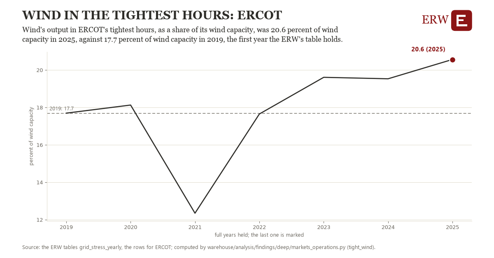

# Wind in the tightest hours: ERCOT

Draft `scan-deep-7056679e00ea` of the findings hunt over the whole warehouse (chain 164), 2026-11-06. State: draft, not reviewed. Review at `/internal/findings`.

**The finding.** Wind's output in ERCOT's tightest hours, as a share of its wind capacity, was 20.6 percent of wind capacity in 2025, against 17.7 percent of wind capacity in 2019, the first year the ERW's table holds.

**The figure by full year** (percent of wind capacity): 2019: 17.7, 2020: 18.1, 2021: 12.3, 2022: 17.6, 2023: 19.6, 2024: 19.5, 2025: 20.6.

**The tables and rows.** `grid_stress_yearly`; the rows for ERCOT, region key `ercot_tight_wind` (the card's `hunt.region`), years 2019 to 2025. The yearly values: `tight-wind-ercot-tight-wind.csv`.

**Its strength.** The change is 1.29 typical yearly moves (a typical move is 2.2 percent of wind capacity, 1.4826 times the median absolute change between full years). Holds in more than one year: 4 of the 6 full years after 2019 lie above 2019's value. Survives a change of window: from 2020 to 2025 the change is 2.4, from 2019 to 2024 it is 1.8. Sample large enough: 2019 holds 1 and 2025 holds 1 observations; the floor is 1. Half the change remains without the first year: from 2020 to 2025 the change is 2.4, 84.9 percent of the change from 2019. At least one typical yearly move: the change is 1.29 typical yearly moves (2.2 percent of wind capacity a year, the median move between full years); the floor is 1.

**Its limits.** The ERW's derived grid_stress_yearly (EIA-930 hourly by source, EIA's generator inventory); the tightest hours are the year's hours of highest net load, and a grid whose capacity grew late in a year shows a share of a capacity it held only in part. 

**Reproduce.** `python tight-wind-ercot-tight-wind.reproduce.py <the table's CSV>` and `do tight-wind-ercot-tight-wind.reproduce.do` (Stata) recompute the figures by year from the tables as the public downloads hold them; each names the expected values at its top.
