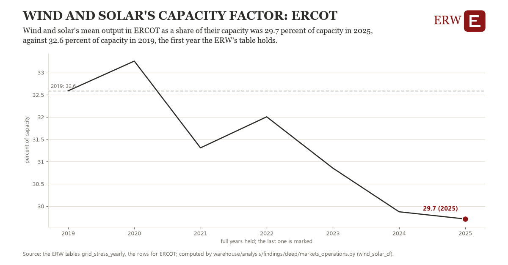

# Wind and solar's capacity factor: ERCOT

Draft `scan-deep-691859bc9a8b` of the findings hunt over the whole warehouse (chain 164), 2026-11-06. State: draft, not reviewed. Review at `/internal/findings`.

**The finding.** Wind and solar's mean output in ERCOT as a share of their capacity was 29.7 percent of capacity in 2025, against 32.6 percent of capacity in 2019, the first year the ERW's table holds.

**The figure by full year** (percent of capacity): 2019: 32.6, 2020: 33.3, 2021: 31.3, 2022: 32.0, 2023: 30.9, 2024: 29.9, 2025: 29.7.

**The tables and rows.** `grid_stress_yearly`; the rows for ERCOT, region key `ercot_wind_solar_cf` (the card's `hunt.region`), years 2019 to 2025. The yearly values: `wind-solar-cf-ercot-wind-solar-cf.csv`.

**Its strength.** The change is 2.31 typical yearly moves (a typical move is 1.2 percent of capacity, 1.4826 times the median absolute change between full years). Holds in more than one year: 5 of the 6 full years after 2019 lie below 2019's value. Survives a change of window: from 2020 to 2025 the change is -3.5, from 2019 to 2024 it is -2.7. Sample large enough: 2019 holds 1 and 2025 holds 1 observations; the floor is 1. Half the change remains without the first year: from 2020 to 2025 the change is -3.5, 123.2 percent of the change from 2019. At least one typical yearly move: the change is 2.31 typical yearly moves (1.2 percent of capacity a year, the median move between full years); the floor is 1.

**Its limits.** The ERW's derived grid_stress_yearly (EIA-930 hourly by source, EIA's generator inventory); the tightest hours are the year's hours of highest net load, and a grid whose capacity grew late in a year shows a share of a capacity it held only in part. 

**Reproduce.** `python wind-solar-cf-ercot-wind-solar-cf.reproduce.py <the table's CSV>` and `do wind-solar-cf-ercot-wind-solar-cf.reproduce.do` (Stata) recompute the figures by year from the tables as the public downloads hold them; each names the expected values at its top.
