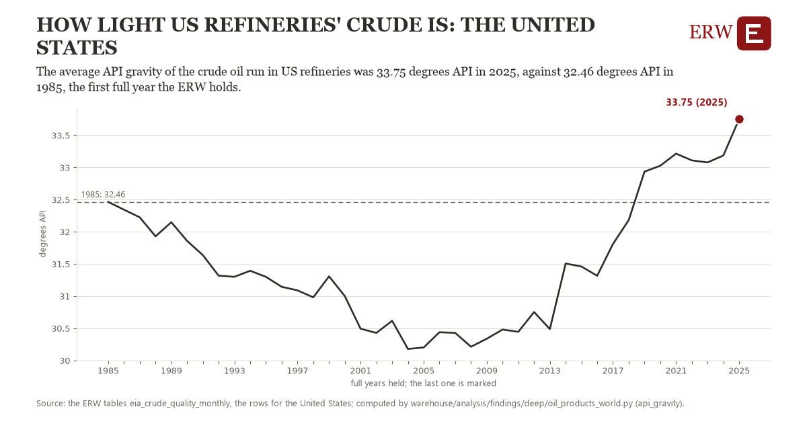

# How light us refineries' crude is: the United States

Draft `scan-deep-0607c5f8ab90` of the findings hunt over the whole warehouse (chain 164), 2026-11-06. State: draft, not reviewed. Review at `/internal/findings`.

**The finding.** The average API gravity of the crude oil run in US refineries was 33.75 degrees API in 2025, against 32.46 degrees API in 1985, the first full year the ERW holds.

**The figure by full year** (degrees API): 1985: 32.46, 1986: 32.34, 1987: 32.22, 1988: 31.93, 1989: 32.15, 1990: 31.86, 1991: 31.64, 1992: 31.32, 1993: 31.30, 1994: 31.39, 1995: 31.30, 1996: 31.14, 1997: 31.09, 1998: 30.98, 1999: 31.31, 2000: 31.00, 2001: 30.49, 2002: 30.43, 2003: 30.62, 2004: 30.18, 2005: 30.20, 2006: 30.44, 2007: 30.43, 2008: 30.21, 2009: 30.34, 2010: 30.48, 2011: 30.44, 2012: 30.75, 2013: 30.49, 2014: 31.51, 2015: 31.46, 2016: 31.32, 2017: 31.81, 2018: 32.18, 2019: 32.93, 2020: 33.03, 2021: 33.22, 2022: 33.11, 2023: 33.08, 2024: 33.19, 2025: 33.75.

**The tables and rows.** `eia_crude_quality_monthly`; the rows for the United States, region key `us_api_gravity` (the card's `hunt.region`), years 1985 to 2025. The yearly values: `api-gravity-us-api-gravity.csv`.

**Its strength.** The change is 5.07 typical yearly moves (a typical move is 0.25 degrees API, 1.4826 times the median absolute change between full years). Holds in more than one year: 7 of the 40 full years after 1985 lie above 1985's value. Survives a change of window: from 1986 to 2025 the change is 1.41, from 1985 to 2024 it is 0.72. Sample large enough: 1985 holds 12 and 2025 holds 12 observations; the floor is 11. Half the change remains without the first year: from 1986 to 2025 the change is 1.41, 109.3 percent of the change from 1985. At least one typical yearly move: the change is 5.07 typical yearly moves (0.25 degrees API a year, the median move between full years); the floor is 1.

**Its limits.** EIA's monthly figures as published, the latest months preliminary. A higher API gravity is a lighter crude.

**Reproduce.** `python api-gravity-us-api-gravity.reproduce.py <the table's CSV>` and `do api-gravity-us-api-gravity.reproduce.do` (Stata) recompute the figures by year from the tables as the public downloads hold them; each names the expected values at its top.
