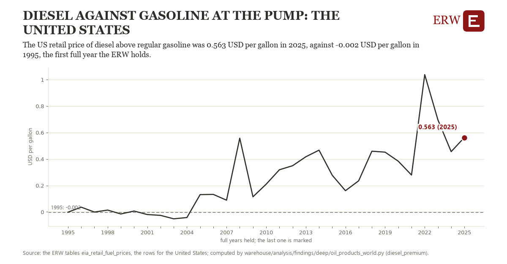

# Diesel against gasoline at the pump: the United States

Draft `scan-deep-e68a3453e8ec` of the findings hunt over the whole warehouse (chain 164), 2026-11-06. State: draft, not reviewed. Review at `/internal/findings`.

**The finding.** The US retail price of diesel above regular gasoline was 0.563 USD per gallon in 2025, against -0.002 USD per gallon in 1995, the first full year the ERW holds.

**The figure by full year** (USD per gallon): 1995: -0.002, 1996: 0.036, 1997: -0.001, 1998: 0.014, 1999: -0.015, 2000: 0.007, 2001: -0.020, 2002: -0.026, 2003: -0.052, 2004: -0.042, 2005: 0.131, 2006: 0.133, 2007: 0.089, 2008: 0.557, 2009: 0.115, 2010: 0.210, 2011: 0.319, 2012: 0.349, 2013: 0.417, 2014: 0.467, 2015: 0.277, 2016: 0.161, 2017: 0.235, 2018: 0.459, 2019: 0.452, 2020: 0.383, 2021: 0.279, 2022: 1.038, 2023: 0.695, 2024: 0.456, 2025: 0.563.

**The tables and rows.** `eia_retail_fuel_prices`; the rows for the United States, region key `us_diesel_premium` (the card's `hunt.region`), years 1995 to 2025. The yearly values: `diesel-premium-us-diesel-premium.csv`.

**Its strength.** The change is 5.59 typical yearly moves (a typical move is 0.101 USD per gallon, 1.4826 times the median absolute change between full years). Holds in more than one year: 25 of the 30 full years after 1995 lie above 1995's value. Survives a change of window: from 1996 to 2025 the change is 0.526, from 1995 to 2024 it is 0.457. Sample large enough: 1995 holds 52 and 2025 holds 52 observations; the floor is 45. Half the change remains without the first year: from 1996 to 2025 the change is 0.526, 93.3 percent of the change from 1995. At least one typical yearly move: the change is 5.59 typical yearly moves (0.101 USD per gallon a year, the median move between full years); the floor is 1.

**Its limits.** EIA's weekly retail prices, nominal dollars, taxes included; federal and state taxes differ between the two fuels.

**Reproduce.** `python diesel-premium-us-diesel-premium.reproduce.py <the table's CSV>` and `do diesel-premium-us-diesel-premium.reproduce.do` (Stata) recompute the figures by year from the tables as the public downloads hold them; each names the expected values at its top.
