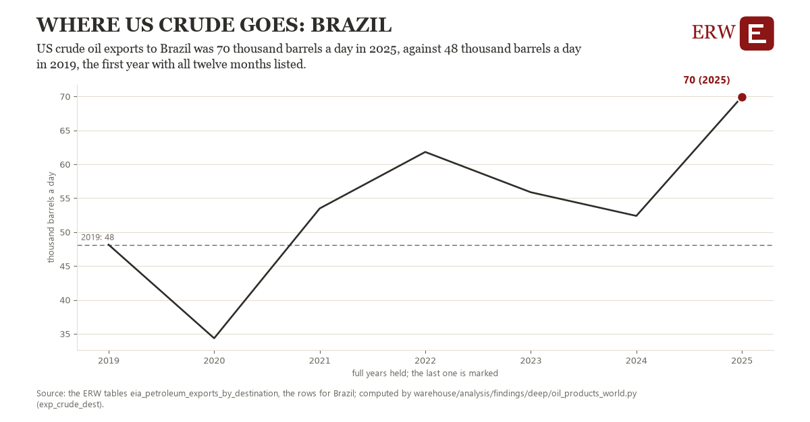

# Where us crude goes: Brazil

Draft `scan-deep-c30883b9241a` of the findings hunt over the whole warehouse (chain 502), 2026-11-19. State: draft, not reviewed. Review at `/internal/findings`.

**The finding.** US crude oil exports to Brazil were 70 thousand barrels a day in 2025, against 48 thousand barrels a day in 2019, the first year with all twelve months listed.

**The figure by full year** (thousand barrels a day): 2019: 48, 2020: 34, 2021: 53, 2022: 62, 2023: 56, 2024: 52, 2025: 70.

**The tables and rows.** `eia_petroleum_exports_by_destination`; the rows for Brazil, region key `xc_nbr` (the card's `hunt.region`), years 2019 to 2025. The yearly values: `exp-crude-dest-xc-nbr.csv`.

**Its strength.** The change is 1.33 typical yearly moves (a typical move is 16 thousand barrels a day, 1.4826 times the median absolute change between full years). Holds in more than one year: 5 of the 6 full years after 2019 lie above 2019's value. Survives a change of window: from 2020 to 2025 the change is 36, from 2019 to 2024 it is 4. Sample large enough: 2019 holds 12 and 2025 holds 12 observations; the floor is 12. Half the change remains without the first year: from 2020 to 2025 the change is 36, 163.3 percent of the change from 2019. At least one typical yearly move: the change is 1.33 typical yearly moves (16 thousand barrels a day a year, the median move between full years); the floor is 1.

**Its limits.** EIA's exports by destination as published, the latest months preliminary; a destination is the first one shipped to, not always where the oil is used. A month with no row is not taken for zero: a year counts only with all twelve months listed.

**Reproduce.** `python exp-crude-dest-xc-nbr.reproduce.py <the table's CSV>` and `do exp-crude-dest-xc-nbr.reproduce.do` (Stata) recompute the figures by year from the tables as the public downloads hold them; each names the expected values at its top.
