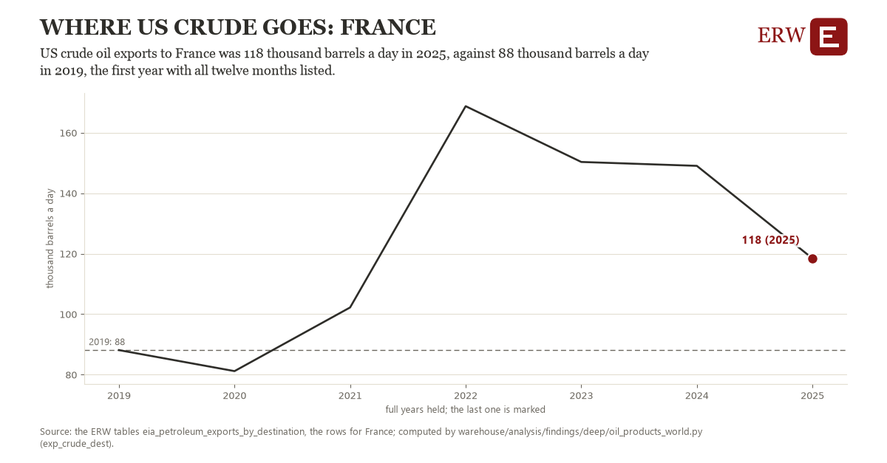

# Where us crude goes: France

Draft `scan-deep-891fb72648a6` of the findings hunt over the whole warehouse (chain 502), 2026-11-19. State: draft, not reviewed. Review at `/internal/findings`.

**The finding.** US crude oil exports to France was 118 thousand barrels a day in 2025, against 88 thousand barrels a day in 2019, the first year with all twelve months listed.

**The figure by full year** (thousand barrels a day): 2019: 88, 2020: 81, 2021: 102, 2022: 169, 2023: 150, 2024: 149, 2025: 118.

**The tables and rows.** `eia_petroleum_exports_by_destination`; the rows for France, region key `xc_nfr` (the card's `hunt.region`), years 2019 to 2025. The yearly values: `exp-crude-dest-xc-nfr.csv`.

**Its strength.** The change is 1.04 typical yearly moves (a typical move is 29 thousand barrels a day, 1.4826 times the median absolute change between full years). Holds in more than one year: 5 of the 6 full years after 2019 lie above 2019's value. Survives a change of window: from 2020 to 2025 the change is 37, from 2019 to 2024 it is 61. Sample large enough: 2019 holds 12 and 2025 holds 12 observations; the floor is 12. Half the change remains without the first year: from 2020 to 2025 the change is 37, 122.9 percent of the change from 2019. At least one typical yearly move: the change is 1.04 typical yearly moves (29 thousand barrels a day a year, the median move between full years); the floor is 1.

**Its limits.** EIA's exports by destination as published, the latest months preliminary; a destination is the first one shipped to, not always where the oil is used. A month with no row is not taken for zero: a year counts only with all twelve months listed.

**Reproduce.** `python exp-crude-dest-xc-nfr.reproduce.py <the table's CSV>` and `do exp-crude-dest-xc-nfr.reproduce.do` (Stata) recompute the figures by year from the tables as the public downloads hold them; each names the expected values at its top.
