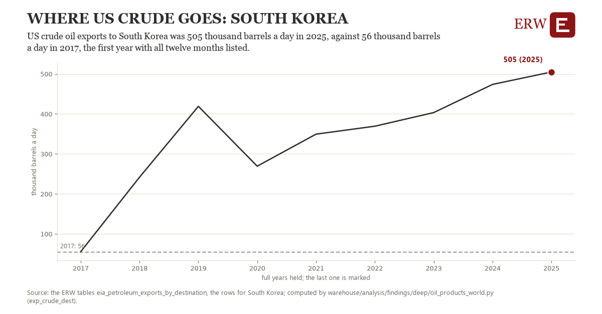

# Where us crude goes: South Korea

Draft `scan-deep-8650698d9d92` of the findings hunt over the whole warehouse (chain 502), 2026-11-19. State: draft, not reviewed. Review at `/internal/findings`.

**The finding.** US crude oil exports to South Korea were 505 thousand barrels a day in 2025, against 56 thousand barrels a day in 2017, the first year with all twelve months listed.

**The figure by full year** (thousand barrels a day): 2017: 56, 2018: 242, 2019: 419, 2020: 269, 2021: 349, 2022: 369, 2023: 403, 2024: 474, 2025: 505.

**The tables and rows.** `eia_petroleum_exports_by_destination`; the rows for South Korea, region key `xc_nks` (the card's `hunt.region`), years 2017 to 2025. The yearly values: `exp-crude-dest-xc-nks.csv`.

**Its strength.** The change is 4.03 typical yearly moves (a typical move is 112 thousand barrels a day, 1.4826 times the median absolute change between full years). Holds in more than one year: 8 of the 8 full years after 2017 lie above 2017's value. Survives a change of window: from 2018 to 2025 the change is 263, from 2017 to 2024 it is 418. Sample large enough: 2017 holds 12 and 2025 holds 12 observations; the floor is 12. Half the change remains without the first year: from 2018 to 2025 the change is 263, 58.5 percent of the change from 2017. At least one typical yearly move: the change is 4.03 typical yearly moves (112 thousand barrels a day a year, the median move between full years); the floor is 1.

**Its limits.** EIA's exports by destination as published, the latest months preliminary; a destination is the first one shipped to, not always where the oil is used. A month with no row is not taken for zero: a year counts only with all twelve months listed.

**Reproduce.** `python exp-crude-dest-xc-nks.reproduce.py <the table's CSV>` and `do exp-crude-dest-xc-nks.reproduce.do` (Stata) recompute the figures by year from the tables as the public downloads hold them; each names the expected values at its top.
