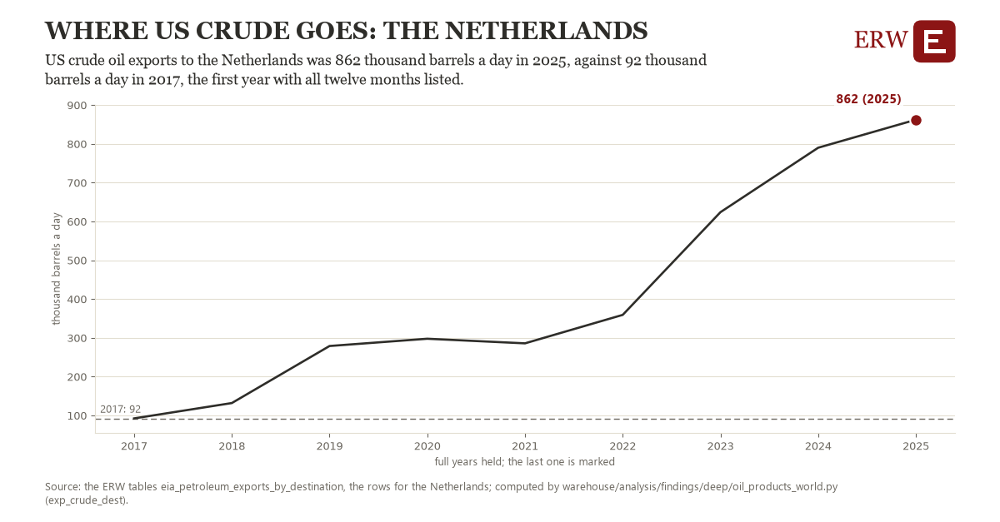

# Where us crude goes: the Netherlands

Draft `scan-deep-0342ef98178d` of the findings hunt over the whole warehouse (chain 502), 2026-11-19. State: draft, not reviewed. Review at `/internal/findings`.

**The finding.** US crude oil exports to the Netherlands was 862 thousand barrels a day in 2025, against 92 thousand barrels a day in 2017, the first year with all twelve months listed.

**The figure by full year** (thousand barrels a day): 2017: 92, 2018: 132, 2019: 279, 2020: 298, 2021: 286, 2022: 359, 2023: 624, 2024: 790, 2025: 862.

**The tables and rows.** `eia_petroleum_exports_by_destination`; the rows for the Netherlands, region key `xc_nnl` (the card's `hunt.region`), years 2017 to 2025. The yearly values: `exp-crude-dest-xc-nnl.csv`.

**Its strength.** The change is 7.13 typical yearly moves (a typical move is 108 thousand barrels a day, 1.4826 times the median absolute change between full years). Holds in more than one year: 8 of the 8 full years after 2017 lie above 2017's value. Survives a change of window: from 2018 to 2025 the change is 730, from 2017 to 2024 it is 698. Sample large enough: 2017 holds 12 and 2025 holds 12 observations; the floor is 12. Half the change remains without the first year: from 2018 to 2025 the change is 730, 94.9 percent of the change from 2017. At least one typical yearly move: the change is 7.13 typical yearly moves (108 thousand barrels a day a year, the median move between full years); the floor is 1.

**Its limits.** EIA's exports by destination as published, the latest months preliminary; a destination is the first one shipped to, not always where the oil is used. A month with no row is not taken for zero: a year counts only with all twelve months listed.

**Reproduce.** `python exp-crude-dest-xc-nnl.reproduce.py <the table's CSV>` and `do exp-crude-dest-xc-nnl.reproduce.do` (Stata) recompute the figures by year from the tables as the public downloads hold them; each names the expected values at its top.
