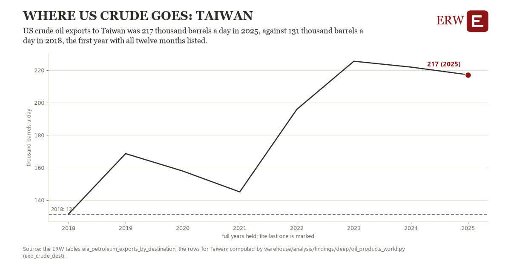

# Where us crude goes: Taiwan

Draft `scan-deep-1db607c0194f` of the findings hunt over the whole warehouse (chain 502), 2026-11-19. State: draft, not reviewed. Review at `/internal/findings`.

**The finding.** US crude oil exports to Taiwan were 217 thousand barrels a day in 2025, against 131 thousand barrels a day in 2018, the first year with all twelve months listed.

**The figure by full year** (thousand barrels a day): 2018: 131, 2019: 169, 2020: 158, 2021: 145, 2022: 196, 2023: 225, 2024: 222, 2025: 217.

**The tables and rows.** `eia_petroleum_exports_by_destination`; the rows for Taiwan, region key `xc_ntw` (the card's `hunt.region`), years 2018 to 2025. The yearly values: `exp-crude-dest-xc-ntw.csv`.

**Its strength.** The change is 4.50 typical yearly moves (a typical move is 19 thousand barrels a day, 1.4826 times the median absolute change between full years). Holds in more than one year: 7 of the 7 full years after 2018 lie above 2018's value. Survives a change of window: from 2019 to 2025 the change is 49, from 2018 to 2024 it is 90. Sample large enough: 2018 holds 12 and 2025 holds 12 observations; the floor is 12. Half the change remains without the first year: from 2019 to 2025 the change is 49, 56.6 percent of the change from 2018. At least one typical yearly move: the change is 4.50 typical yearly moves (19 thousand barrels a day a year, the median move between full years); the floor is 1.

**Its limits.** EIA's exports by destination as published, the latest months preliminary; a destination is the first one shipped to, not always where the oil is used. A month with no row is not taken for zero: a year counts only with all twelve months listed.

**Reproduce.** `python exp-crude-dest-xc-ntw.reproduce.py <the table's CSV>` and `do exp-crude-dest-xc-ntw.reproduce.do` (Stata) recompute the figures by year from the tables as the public downloads hold them; each names the expected values at its top.
