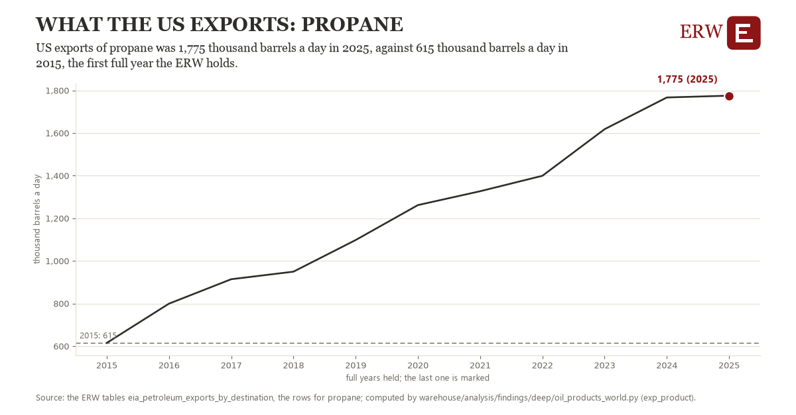

# What the us exports: propane

Draft `scan-deep-87f03367a49a` of the findings hunt over the whole warehouse (chain 502), 2026-11-19. State: draft, not reviewed. Review at `/internal/findings`.

**The finding.** US exports of propane was 1,775 thousand barrels a day in 2025, against 615 thousand barrels a day in 2015, the first full year the ERW holds.

**The figure by full year** (thousand barrels a day): 2015: 615, 2016: 799, 2017: 914, 2018: 949, 2019: 1,098, 2020: 1,262, 2021: 1,327, 2022: 1,399, 2023: 1,618, 2024: 1,767, 2025: 1,775.

**The tables and rows.** `eia_petroleum_exports_by_destination`; the rows for propane, region key `xp_epllpa` (the card's `hunt.region`), years 2015 to 2025. The yearly values: `exp-product-xp-epllpa.csv`.

**Its strength.** The change is 5.95 typical yearly moves (a typical move is 195 thousand barrels a day, 1.4826 times the median absolute change between full years). Holds in more than one year: 10 of the 10 full years after 2015 lie above 2015's value. Survives a change of window: from 2016 to 2025 the change is 976, from 2015 to 2024 it is 1,152. Sample large enough: 2015 holds 12 and 2025 holds 12 observations; the floor is 12. Half the change remains without the first year: from 2016 to 2025 the change is 976, 84.1 percent of the change from 2015. At least one typical yearly move: the change is 5.95 typical yearly moves (195 thousand barrels a day a year, the median move between full years); the floor is 1.

**Its limits.** EIA's exports by destination as published, the latest months preliminary; a destination is the first one shipped to, not always where the oil is used.

**Reproduce.** `python exp-product-xp-epllpa.reproduce.py <the table's CSV>` and `do exp-product-xp-epllpa.reproduce.do` (Stata) recompute the figures by year from the tables as the public downloads hold them; each names the expected values at its top.
