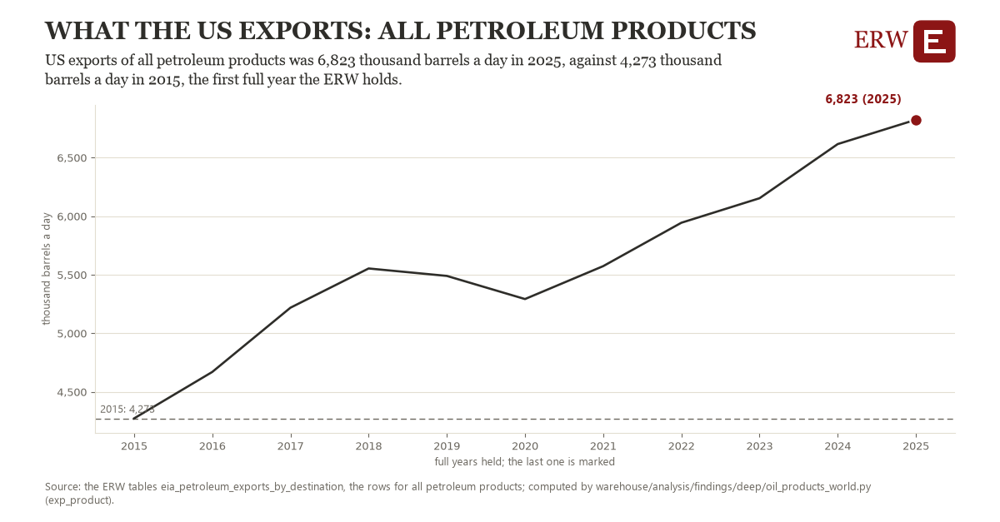

# What the us exports: all petroleum products

Draft `scan-deep-08067f5a918f` of the findings hunt over the whole warehouse (chain 502), 2026-11-19. State: draft, not reviewed. Review at `/internal/findings`.

**The finding.** US exports of all petroleum products were 6,823 thousand barrels a day in 2025, against 4,273 thousand barrels a day in 2015, the first full year the ERW holds.

**The figure by full year** (thousand barrels a day): 2015: 4,273, 2016: 4,670, 2017: 5,218, 2018: 5,553, 2019: 5,490, 2020: 5,292, 2021: 5,573, 2022: 5,944, 2023: 6,153, 2024: 6,615, 2025: 6,823.

**The tables and rows.** `eia_petroleum_exports_by_destination`; the rows for all petroleum products, region key `xp_epp0` (the card's `hunt.region`), years 2015 to 2025. The yearly values: `exp-product-xp-epp0.csv`.

**Its strength.** The change is 5.59 typical yearly moves (a typical move is 457 thousand barrels a day, 1.4826 times the median absolute change between full years). Holds in more than one year: 10 of the 10 full years after 2015 lie above 2015's value. Survives a change of window: from 2016 to 2025 the change is 2,154, from 2015 to 2024 it is 2,342. Sample large enough: 2015 holds 12 and 2025 holds 12 observations; the floor is 12. Half the change remains without the first year: from 2016 to 2025 the change is 2,154, 84.4 percent of the change from 2015. At least one typical yearly move: the change is 5.59 typical yearly moves (457 thousand barrels a day a year, the median move between full years); the floor is 1.

**Its limits.** EIA's exports by destination as published, the latest months preliminary; a destination is the first one shipped to, not always where the oil is used.

**Reproduce.** `python exp-product-xp-epp0.reproduce.py <the table's CSV>` and `do exp-product-xp-epp0.reproduce.do` (Stata) recompute the figures by year from the tables as the public downloads hold them; each names the expected values at its top.
