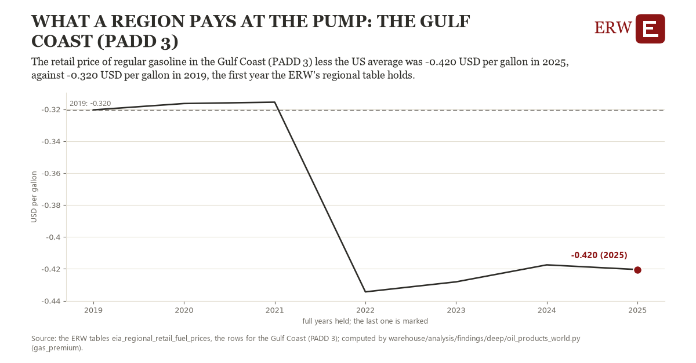

# What a region pays at the pump: the Gulf Coast (PADD 3)

Draft `scan-deep-1304854e183c` of the findings hunt over the whole warehouse (chain 164), 2026-11-06. State: draft, not reviewed. Review at `/internal/findings`.

**The finding.** The retail price of regular gasoline in the Gulf Coast (PADD 3) less the US average was -0.420 USD per gallon in 2025, against -0.320 USD per gallon in 2019, the first year the ERW's regional table holds.

**The figure by full year** (USD per gallon): 2019: -0.320, 2020: -0.316, 2021: -0.316, 2022: -0.434, 2023: -0.428, 2024: -0.417, 2025: -0.420.

**The tables and rows.** `eia_regional_retail_fuel_prices`; the rows for the Gulf Coast (PADD 3), region key `gasprem_R30` (the card's `hunt.region`), years 2019 to 2025. The yearly values: `gas-premium-gasprem-r30.csv`.

**Its strength.** The change is 13.16 typical yearly moves (a typical move is 0.008 USD per gallon, 1.4826 times the median absolute change between full years). Holds in more than one year: 4 of the 6 full years after 2019 lie below 2019's value. Survives a change of window: from 2020 to 2025 the change is -0.104, from 2019 to 2024 it is -0.097. Sample large enough: 2019 holds 52 and 2025 holds 52 observations; the floor is 45. Half the change remains without the first year: from 2020 to 2025 the change is -0.104, 104.0 percent of the change from 2019. At least one typical yearly move: the change is 13.16 typical yearly moves (0.008 USD per gallon a year, the median move between full years); the floor is 1.

**Its limits.** EIA's weekly retail prices, nominal dollars, taxes included; the ERW's regional table begins in 2019.

**Reproduce.** `python gas-premium-gasprem-r30.reproduce.py <the table's CSV>` and `do gas-premium-gasprem-r30.reproduce.do` (Stata) recompute the figures by year from the tables as the public downloads hold them; each names the expected values at its top.
