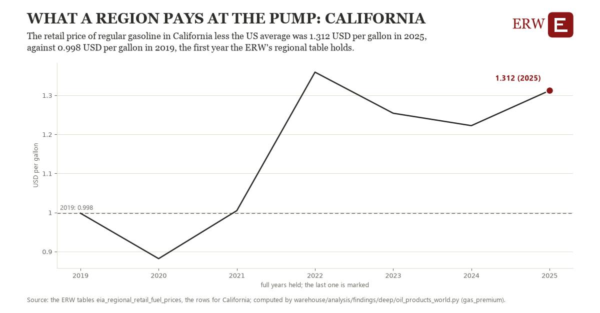

# What a region pays at the pump: California

Draft `scan-deep-e4ec068bcbd3` of the findings hunt over the whole warehouse (chain 164), 2026-11-06. State: draft, not reviewed. Review at `/internal/findings`.

**The finding.** The retail price of regular gasoline in California less the US average was 1.312 USD per gallon in 2025, against 0.998 USD per gallon in 2019, the first year the ERW's regional table holds.

**The figure by full year** (USD per gallon): 2019: 0.998, 2020: 0.882, 2021: 1.005, 2022: 1.359, 2023: 1.254, 2024: 1.222, 2025: 1.312.

**The tables and rows.** `eia_regional_retail_fuel_prices`; the rows for California, region key `gasprem_SCA` (the card's `hunt.region`), years 2019 to 2025. The yearly values: `gas-premium-gasprem-sca.csv`.

**Its strength.** The change is 1.91 typical yearly moves (a typical move is 0.164 USD per gallon, 1.4826 times the median absolute change between full years). Holds in more than one year: 5 of the 6 full years after 2019 lie above 2019's value. Survives a change of window: from 2020 to 2025 the change is 0.430, from 2019 to 2024 it is 0.224. Sample large enough: 2019 holds 52 and 2025 holds 52 observations; the floor is 45. Half the change remains without the first year: from 2020 to 2025 the change is 0.430, 137.0 percent of the change from 2019. At least one typical yearly move: the change is 1.91 typical yearly moves (0.164 USD per gallon a year, the median move between full years); the floor is 1.

**Its limits.** EIA's weekly retail prices, nominal dollars, taxes included; the ERW's regional table begins in 2019.

**Reproduce.** `python gas-premium-gasprem-sca.reproduce.py <the table's CSV>` and `do gas-premium-gasprem-sca.reproduce.do` (Stata) recompute the figures by year from the tables as the public downloads hold them; each names the expected values at its top.
