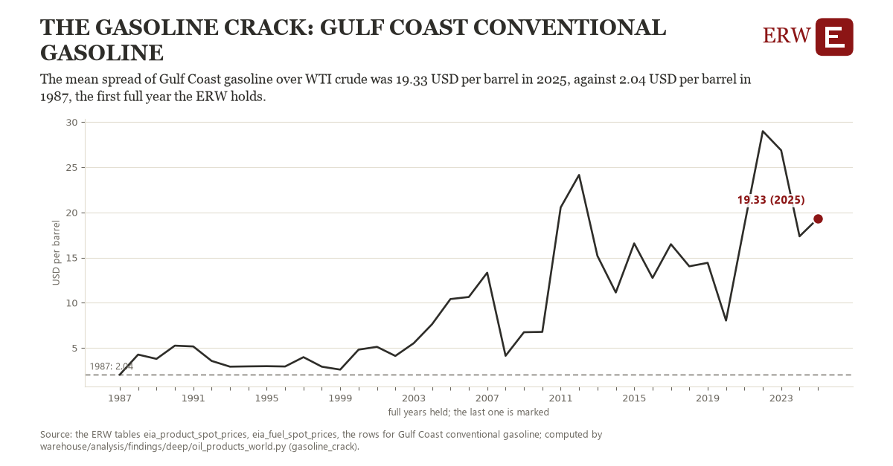

# The gasoline crack: Gulf Coast conventional gasoline

Draft `scan-deep-960efb8eb1e1` of the findings hunt over the whole warehouse (chain 164), 2026-11-06. State: draft, not reviewed. Review at `/internal/findings`.

**The finding.** The mean spread of Gulf Coast gasoline over WTI crude was 19.33 USD per barrel in 2025, against 2.04 USD per barrel in 1987, the first full year the ERW holds.

**The figure by full year** (USD per barrel): 1987: 2.04, 1988: 4.26, 1989: 3.79, 1990: 5.25, 1991: 5.16, 1992: 3.56, 1993: 2.92, 1994: 2.96, 1995: 2.98, 1996: 2.94, 1997: 3.98, 1998: 2.92, 1999: 2.60, 2000: 4.81, 2001: 5.12, 2002: 4.11, 2003: 5.52, 2004: 7.63, 2005: 10.41, 2006: 10.64, 2007: 13.32, 2008: 4.12, 2009: 6.74, 2010: 6.77, 2011: 20.55, 2012: 24.14, 2013: 15.18, 2014: 11.13, 2015: 16.57, 2016: 12.75, 2017: 16.48, 2018: 14.03, 2019: 14.42, 2020: 8.03, 2021: 18.60, 2022: 28.99, 2023: 26.87, 2024: 17.35, 2025: 19.33.

**The tables and rows.** `eia_product_spot_prices`, `eia_fuel_spot_prices`; the rows for Gulf Coast conventional gasoline, region key `crack_gasoline` (the card's `hunt.region`), years 1987 to 2025. The yearly values: `gasoline-crack-crack-gasoline.csv`.

**Its strength.** The change is 5.52 typical yearly moves (a typical move is 3.13 USD per barrel, 1.4826 times the median absolute change between full years). Holds in more than one year: 38 of the 38 full years after 1987 lie above 1987's value. Survives a change of window: from 1988 to 2025 the change is 15.07, from 1987 to 2024 it is 15.31. Sample large enough: 1987 holds 252 and 2025 holds 248 observations; the floor is 200. Half the change remains without the first year: from 1988 to 2025 the change is 15.07, 87.1 percent of the change from 1987. At least one typical yearly move: the change is 5.52 typical yearly moves (3.13 USD per barrel a year, the median move between full years); the floor is 1.

**Its limits.** EIA's daily spot closes, nominal dollars; a crack is the product less crude at one place, not a refiner's margin, which counts its own crude and costs.

**Reproduce.** `python gasoline-crack-crack-gasoline.reproduce.py <the table's CSV>` and `do gasoline-crack-crack-gasoline.reproduce.do` (Stata) recompute the figures by year from the tables as the public downloads hold them; each names the expected values at its top.
