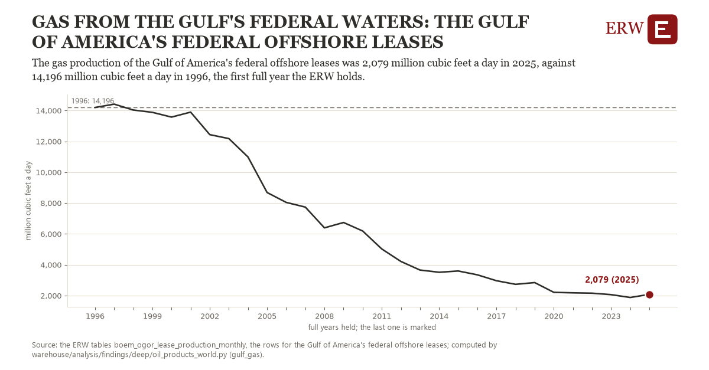

# Gas from the gulf's federal waters: the Gulf of America's federal offshore leases

Draft `scan-deep-4e59592589dd` of the findings hunt over the whole warehouse (chain 502), 2026-11-19. State: draft, not reviewed. Review at `/internal/findings`.

**The finding.** The gas production of the Gulf of America's federal offshore leases was 2,079 million cubic feet a day in 2025, against 14,196 million cubic feet a day in 1996, the first full year the ERW holds.

**The figure by full year** (million cubic feet a day): 1996: 14,196, 1997: 14,413, 1998: 14,032, 1999: 13,880, 2000: 13,573, 2001: 13,896, 2002: 12,436, 2003: 12,179, 2004: 10,987, 2005: 8,683, 2006: 8,041, 2007: 7,737, 2008: 6,391, 2009: 6,739, 2010: 6,188, 2011: 5,023, 2012: 4,213, 2013: 3,655, 2014: 3,512, 2015: 3,594, 2016: 3,346, 2017: 2,963, 2018: 2,730, 2019: 2,842, 2020: 2,211, 2021: 2,177, 2022: 2,155, 2023: 2,060, 2024: 1,876, 2025: 2,079.

**The tables and rows.** `boem_ogor_lease_production_monthly`; the rows for the Gulf of America's federal offshore leases, region key `gulf` (the card's `hunt.region`), years 1996 to 2025. The yearly values: `gulf-gas-gulf.csv`.

**Its strength.** The change is 26.60 typical yearly moves (a typical move is 456 million cubic feet a day, 1.4826 times the median absolute change between full years). Holds in more than one year: 28 of the 29 full years after 1996 lie below 1996's value. Survives a change of window: from 1997 to 2025 the change is -12,334, from 1996 to 2024 it is -12,320. Sample large enough: 1996 holds 12 and 2025 holds 12 observations; the floor is 12. Half the change remains without the first year: from 1997 to 2025 the change is -12,334, 101.8 percent of the change from 1996. At least one typical yearly move: the change is 26.60 typical yearly moves (456 million cubic feet a day a year, the median move between full years); the floor is 1.

**Its limits.** BOEM's OGOR-A well production as the ERW sums it by lease, the Gulf of America's federal waters only; the latest months are revised as operators report.

**Reproduce.** `python gulf-gas-gulf.reproduce.py <the table's CSV>` and `do gulf-gas-gulf.reproduce.do` (Stata) recompute the figures by year from the tables as the public downloads hold them; each names the expected values at its top.
