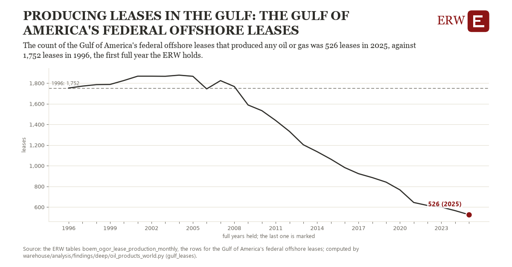

# Producing leases in the gulf: the Gulf of America's federal offshore leases

Draft `scan-deep-4bada312e541` of the findings hunt over the whole warehouse (chain 502), 2026-11-19. State: draft, not reviewed. Review at `/internal/findings`.

**The finding.** The count of the Gulf of America's federal offshore leases that produced any oil or gas was 526 leases in 2025, against 1,752 leases in 1996, the first full year the ERW holds.

**The figure by full year** (leases): 1996: 1,752, 1997: 1,771, 1998: 1,785, 1999: 1,787, 2000: 1,825, 2001: 1,867, 2002: 1,867, 2003: 1,866, 2004: 1,877, 2005: 1,866, 2006: 1,744, 2007: 1,824, 2008: 1,767, 2009: 1,588, 2010: 1,533, 2011: 1,438, 2012: 1,332, 2013: 1,203, 2014: 1,136, 2015: 1,063, 2016: 982, 2017: 923, 2018: 885, 2019: 841, 2020: 766, 2021: 644, 2022: 615, 2023: 599, 2024: 565, 2025: 526.

**The tables and rows.** `boem_ogor_lease_production_monthly`; the rows for the Gulf of America's federal offshore leases, region key `gulf` (the card's `hunt.region`), years 1996 to 2025. The yearly values: `gulf-leases-gulf.csv`.

**Its strength.** The change is 18.79 typical yearly moves (a typical move is 65 leases, 1.4826 times the median absolute change between full years). Holds in more than one year: 18 of the 29 full years after 1996 lie below 1996's value. Survives a change of window: from 1997 to 2025 the change is -1,245, from 1996 to 2024 it is -1,187. Sample large enough: 1996 holds 12 and 2025 holds 12 observations; the floor is 12. Half the change remains without the first year: from 1997 to 2025 the change is -1,245, 101.5 percent of the change from 1996. At least one typical yearly move: the change is 18.79 typical yearly moves (65 leases a year, the median move between full years); the floor is 1.

**Its limits.** BOEM's OGOR-A well production as the ERW sums it by lease, the Gulf of America's federal waters only; the latest months are revised as operators report.

**Reproduce.** `python gulf-leases-gulf.reproduce.py <the table's CSV>` and `do gulf-leases-gulf.reproduce.do` (Stata) recompute the figures by year from the tables as the public downloads hold them; each names the expected values at its top.
