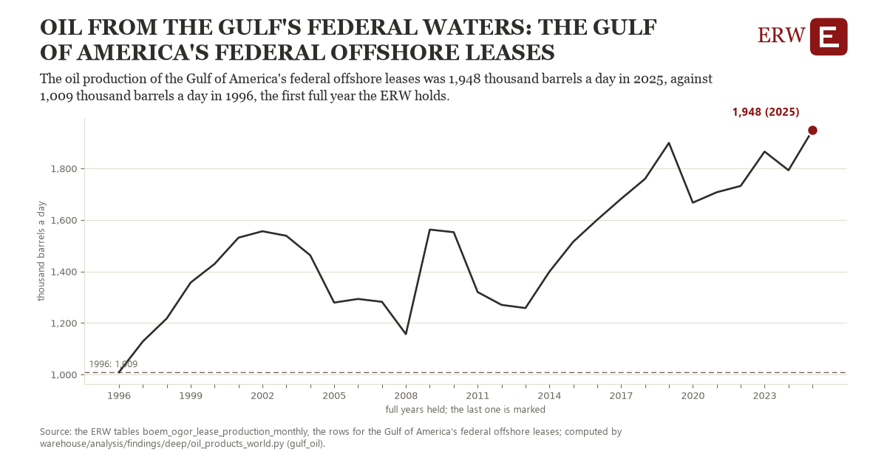

# Oil from the gulf's federal waters: the Gulf of America's federal offshore leases

Draft `scan-deep-2cdfd4d39926` of the findings hunt over the whole warehouse (chain 502), 2026-11-19. State: draft, not reviewed. Review at `/internal/findings`.

**The finding.** The oil production of the Gulf of America's federal offshore leases was 1,948 thousand barrels a day in 2025, against 1,009 thousand barrels a day in 1996, the first full year the ERW holds.

**The figure by full year** (thousand barrels a day): 1996: 1,009, 1997: 1,129, 1998: 1,218, 1999: 1,357, 2000: 1,429, 2001: 1,531, 2002: 1,556, 2003: 1,539, 2004: 1,463, 2005: 1,279, 2006: 1,293, 2007: 1,282, 2008: 1,157, 2009: 1,563, 2010: 1,553, 2011: 1,320, 2012: 1,270, 2013: 1,258, 2014: 1,399, 2015: 1,516, 2016: 1,601, 2017: 1,682, 2018: 1,759, 2019: 1,899, 2020: 1,667, 2021: 1,708, 2022: 1,732, 2023: 1,865, 2024: 1,793, 2025: 1,948.

**The tables and rows.** `boem_ogor_lease_production_monthly`; the rows for the Gulf of America's federal offshore leases, region key `gulf` (the card's `hunt.region`), years 1996 to 2025. The yearly values: `gulf-oil-gulf.csv`.

**Its strength.** The change is 7.43 typical yearly moves (a typical move is 126 thousand barrels a day, 1.4826 times the median absolute change between full years). Holds in more than one year: 29 of the 29 full years after 1996 lie above 1996's value. Survives a change of window: from 1997 to 2025 the change is 819, from 1996 to 2024 it is 784. Sample large enough: 1996 holds 12 and 2025 holds 12 observations; the floor is 12. Half the change remains without the first year: from 1997 to 2025 the change is 819, 87.3 percent of the change from 1996. At least one typical yearly move: the change is 7.43 typical yearly moves (126 thousand barrels a day a year, the median move between full years); the floor is 1.

**Its limits.** BOEM's OGOR-A well production as the ERW sums it by lease, the Gulf of America's federal waters only; the latest months are revised as operators report.

**Reproduce.** `python gulf-oil-gulf.reproduce.py <the table's CSV>` and `do gulf-oil-gulf.reproduce.do` (Stata) recompute the figures by year from the tables as the public downloads hold them; each names the expected values at its top.
