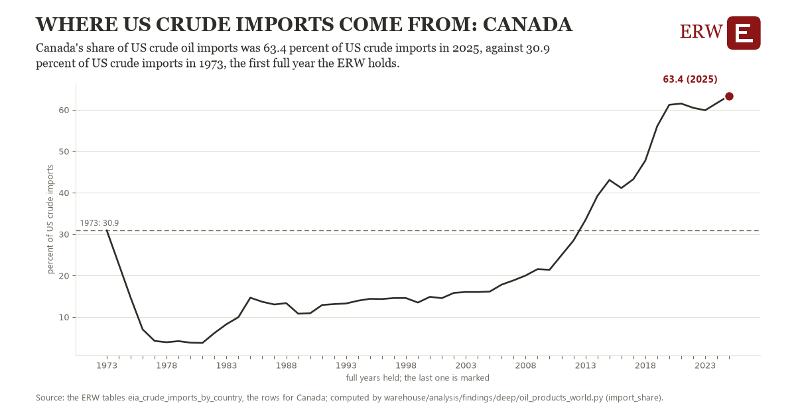

# Where us crude imports come from: Canada

Draft `scan-deep-15ac3afd0745` of the findings hunt over the whole warehouse (chain 164), 2026-11-06. State: draft, not reviewed. Review at `/internal/findings`.

**The finding.** Canada's share of US crude oil imports was 63.4 percent of US crude imports in 2025, against 30.9 percent of US crude imports in 1973, the first full year the ERW holds.

**The figure by full year** (percent of US crude imports): 1973: 30.9, 1974: 22.8, 1975: 14.6, 1976: 7.0, 1977: 4.2, 1978: 3.9, 1979: 4.2, 1980: 3.8, 1981: 3.7, 1982: 6.1, 1983: 8.2, 1984: 9.9, 1985: 14.6, 1986: 13.7, 1987: 13.0, 1988: 13.3, 1989: 10.8, 1990: 10.9, 1991: 12.9, 1992: 13.1, 1993: 13.3, 1994: 13.9, 1995: 14.4, 1996: 14.3, 1997: 14.6, 1998: 14.6, 1999: 13.5, 2000: 14.9, 2001: 14.5, 2002: 15.8, 2003: 16.0, 2004: 16.0, 2005: 16.1, 2006: 17.8, 2007: 18.8, 2008: 20.0, 2009: 21.5, 2010: 21.4, 2011: 24.9, 2012: 28.4, 2013: 33.4, 2014: 39.2, 2015: 43.1, 2016: 41.1, 2017: 43.2, 2018: 47.7, 2019: 56.1, 2020: 61.2, 2021: 61.5, 2022: 60.5, 2023: 59.9, 2024: 61.7, 2025: 63.4.

**The tables and rows.** `eia_crude_imports_by_country`; the rows for Canada, region key `imp_CA` (the card's `hunt.region`), years 1973 to 2025. The yearly values: `import-share-imp-ca.csv`.

**Its strength.** The change is 18.09 typical yearly moves (a typical move is 1.8 percent of US crude imports, 1.4826 times the median absolute change between full years). Holds in more than one year: 13 of the 52 full years after 1973 lie above 1973's value. Survives a change of window: from 1974 to 2025 the change is 40.6, from 1973 to 2024 it is 30.7. Sample large enough: 1973 holds 12 and 2025 holds 12 observations; the floor is 11. Half the change remains without the first year: from 1974 to 2025 the change is 40.6, 124.9 percent of the change from 1973. At least one typical yearly move: the change is 18.09 typical yearly moves (1.8 percent of US crude imports a year, the median move between full years); the floor is 1.

**Its limits.** EIA's imports by country of origin, monthly thousand barrels a day summed over the year; a country's share of a total that itself changed.

**Reproduce.** `python import-share-imp-ca.reproduce.py <the table's CSV>` and `do import-share-imp-ca.reproduce.do` (Stata) recompute the figures by year from the tables as the public downloads hold them; each names the expected values at its top.
