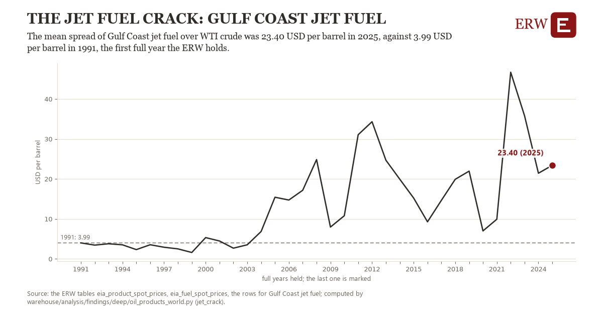

# The jet fuel crack: Gulf Coast jet fuel

Draft `scan-deep-bb200e252fa1` of the findings hunt over the whole warehouse (chain 164), 2026-11-06. State: draft, not reviewed. Review at `/internal/findings`.

**The finding.** The mean spread of Gulf Coast jet fuel over WTI crude was 23.40 USD per barrel in 2025, against 3.99 USD per barrel in 1991, the first full year the ERW holds.

**The figure by full year** (USD per barrel): 1991: 3.99, 1992: 3.43, 1993: 3.77, 1994: 3.51, 1995: 2.31, 1996: 3.53, 1997: 2.90, 1998: 2.50, 1999: 1.59, 2000: 5.32, 2001: 4.47, 2002: 2.67, 2003: 3.52, 2004: 6.84, 2005: 15.42, 2006: 14.71, 2007: 17.16, 2008: 24.84, 2009: 7.95, 2010: 10.79, 2011: 31.06, 2012: 34.31, 2013: 24.68, 2014: 19.93, 2015: 15.21, 2016: 9.26, 2017: 14.63, 2018: 19.90, 2019: 21.94, 2020: 6.99, 2021: 9.91, 2022: 46.69, 2023: 35.78, 2024: 21.42, 2025: 23.40.

**The tables and rows.** `eia_product_spot_prices`, `eia_fuel_spot_prices`; the rows for Gulf Coast jet fuel, region key `crack_jet` (the card's `hunt.region`), years 1991 to 2025. The yearly values: `jet-crack-crack-jet.csv`.

**Its strength.** The change is 4.24 typical yearly moves (a typical move is 4.57 USD per barrel, 1.4826 times the median absolute change between full years). Holds in more than one year: 24 of the 34 full years after 1991 lie above 1991's value. Survives a change of window: from 1992 to 2025 the change is 19.96, from 1991 to 2024 it is 17.43. Sample large enough: 1991 holds 256 and 2025 holds 248 observations; the floor is 200. Half the change remains without the first year: from 1992 to 2025 the change is 19.96, 102.9 percent of the change from 1991. At least one typical yearly move: the change is 4.24 typical yearly moves (4.57 USD per barrel a year, the median move between full years); the floor is 1.

**Its limits.** EIA's daily spot closes, nominal dollars; a crack is the product less crude at one place, not a refiner's margin, which counts its own crude and costs.

**Reproduce.** `python jet-crack-crack-jet.reproduce.py <the table's CSV>` and `do jet-crack-crack-jet.reproduce.do` (Stata) recompute the figures by year from the tables as the public downloads hold them; each names the expected values at its top.
