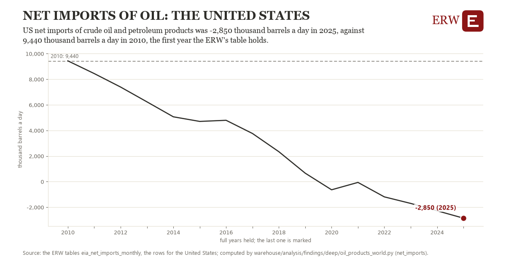

# Net imports of oil: the United States

Draft `scan-deep-10e0e2c5d386` of the findings hunt over the whole warehouse (chain 164), 2026-11-06. State: draft, not reviewed. Review at `/internal/findings`.

**The finding.** US net imports of crude oil and petroleum products was -2,850 thousand barrels a day in 2025, against 9,440 thousand barrels a day in 2010, the first year the ERW's table holds.

**The figure by full year** (thousand barrels a day): 2010: 9,440, 2011: 8,447, 2012: 7,394, 2013: 6,236, 2014: 5,068, 2015: 4,708, 2016: 4,796, 2017: 3,765, 2018: 2,343, 2019: 664, 2020: -634, 2021: -58, 2022: -1,187, 2023: -1,699, 2024: -2,274, 2025: -2,850.

**The tables and rows.** `eia_net_imports_monthly`; the rows for the United States, region key `us_net_imports` (the card's `hunt.region`), years 2010 to 2025. The yearly values: `net-imports-us-net-imports.csv`.

**Its strength.** The change is 8.04 typical yearly moves (a typical move is 1,528 thousand barrels a day, 1.4826 times the median absolute change between full years). Holds in more than one year: 15 of the 15 full years after 2010 lie below 2010's value. Survives a change of window: from 2011 to 2025 the change is -11,297, from 2010 to 2024 it is -11,714. Sample large enough: 2010 holds 12 and 2025 holds 12 observations; the floor is 11. Half the change remains without the first year: from 2011 to 2025 the change is -11,297, 91.9 percent of the change from 2010. At least one typical yearly move: the change is 8.04 typical yearly moves (1,528 thousand barrels a day a year, the median move between full years); the floor is 1.

**Its limits.** EIA's monthly figures, the latest preliminary; a negative figure is net exports.

**Reproduce.** `python net-imports-us-net-imports.reproduce.py <the table's CSV>` and `do net-imports-us-net-imports.reproduce.do` (Stata) recompute the figures by year from the tables as the public downloads hold them; each names the expected values at its top.
