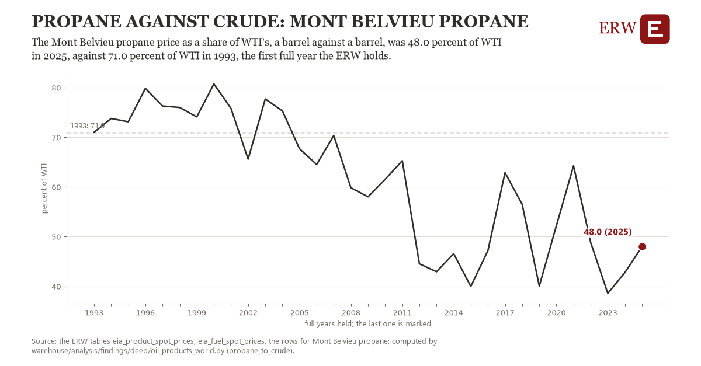

# Propane against crude: Mont Belvieu propane

Draft `scan-deep-479fe9a50745` of the findings hunt over the whole warehouse (chain 164), 2026-11-06. State: draft, not reviewed. Review at `/internal/findings`.

**The finding.** The Mont Belvieu propane price as a share of WTI's, a barrel against a barrel, was 48.0 percent of WTI in 2025, against 71.0 percent of WTI in 1993, the first full year the ERW holds.

**The figure by full year** (percent of WTI): 1993: 71.0, 1994: 73.8, 1995: 73.1, 1996: 79.8, 1997: 76.3, 1998: 76.0, 1999: 74.1, 2000: 80.8, 2001: 75.8, 2002: 65.6, 2003: 77.7, 2004: 75.3, 2005: 67.7, 2006: 64.5, 2007: 70.4, 2008: 59.9, 2009: 58.0, 2010: 61.5, 2011: 65.3, 2012: 44.6, 2013: 43.0, 2014: 46.6, 2015: 40.0, 2016: 47.2, 2017: 62.9, 2018: 56.5, 2019: 40.1, 2020: 52.2, 2021: 64.3, 2022: 48.8, 2023: 38.6, 2024: 42.8, 2025: 48.0.

**The tables and rows.** `eia_product_spot_prices`, `eia_fuel_spot_prices`; the rows for Mont Belvieu propane, region key `us_propane_crude` (the card's `hunt.region`), years 1993 to 2025. The yearly values: `propane-to-crude-us-propane-crude.csv`.

**Its strength.** The change is 2.54 typical yearly moves (a typical move is 9.1 percent of WTI, 1.4826 times the median absolute change between full years). Holds in more than one year: 22 of the 32 full years after 1993 lie below 1993's value. Survives a change of window: from 1994 to 2025 the change is -25.8, from 1993 to 2024 it is -28.2. Sample large enough: 1993 holds 249 and 2025 holds 246 observations; the floor is 200. Half the change remains without the first year: from 1994 to 2025 the change is -25.8, 112.0 percent of the change from 1993. At least one typical yearly move: the change is 2.54 typical yearly moves (9.1 percent of WTI a year, the median move between full years); the floor is 1.

**Its limits.** Spot closes in nominal dollars; a barrel of propane holds less energy than a barrel of crude.

**Reproduce.** `python propane-to-crude-us-propane-crude.reproduce.py <the table's CSV>` and `do propane-to-crude-us-propane-crude.reproduce.do` (Stata) recompute the figures by year from the tables as the public downloads hold them; each names the expected values at its top.
